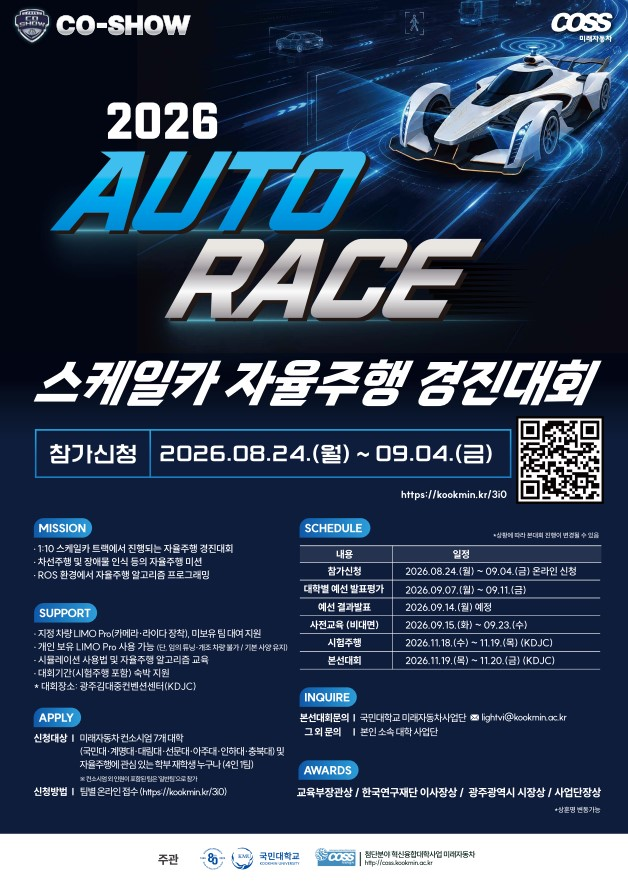

# 2026 AUTO RACE 스케일카 자율주행 경진대회

## Team

<table>
  <tr>
    <td align="center" width="150">
      
    </td>
    <td align="center" width="150">
      
    </td>
    <td align="center" width="150">
      
    </td>
    <td align="center" width="150">
      
    </td>
  </tr>
  <tr>
    <td align="center"><a href="https://github.com/Minjea31">김민재</a></td>
    <td align="center"><a href="https://github.com/ysjee0229">지연수</a></td>
    <td align="center"><a href="https://github.com/mini0909-web">서민영</a></td>
    <td align="center"><a href="https://github.com/ms-c-h">최민성</a></td>
  </tr>
  <tr>
    <td align="center">충북대학교</td>
    <td align="center">충북대학교</td>
    <td align="center">충북대학교</td>
    <td align="center">충북대학교</td>
  </tr>
</table>

## Poster

## Node Flowchart

노드 구조와 노드 간 데이터 흐름은 [노드 구조 Flowchart (Google Drive)](https://drive.google.com/file/d/1IbPikYiX3ACrdugrASQr_ySAeMO6wz26/view?usp=sharing)에서 확인할 수 있습니다.

로컬 [draw.io 원본](docs/2026_AutoRace.drawio), [Flowchart 이미지](docs/2026_AutoRace.png)·[SVG](docs/2026_AutoRace.svg), [토픽·우선순위 명세](docs/architecture.md)도 함께 관리합니다.

## Workspaces

8종 미션을 6개 미션 워크스페이스와 4개 공통 워크스페이스에서 처리합니다. 갈림길 A/B 주행은 `lane_ws`에 통합하며, `/yolo/LR_sign`의 Bool 결과로 좌·우 경로를 선택합니다. `mux_ws`가 선택한 후보를 `geometry_msgs/msg/Twist`로 변환해 차량에 `/cmd_vel`로 직접 발행합니다.

| 구분 | 워크스페이스 | 담당 기능 |
| --- | --- | --- |
| 미션 | [signal_ws](signal_ws/) | 신호등 정지·발진. 방해 광고판이 있는 환경에서 신호 인식 |
| 미션 | [crosswalk_ws](crosswalk_ws/) | YOLO 보행자 표지판 Bool로 정지에 진입하고 lane 명령의 속도만 바꿔 정지·3초 대기·출발 |
| 미션 | [parking_ws](parking_ws/) | 지정 주차 구역에 T자 주차 |
| 미션 | [slow_ws](slow_ws/) (도면 이름 `slow`) | YOLO slow_sign·zigzag Bool 중 하나라도 true이면 서행. lane 조향을 유지하고 속도만 감속 |
| 미션 | [cone_ws](cone_ws/) | 라바콘 회피 주행 |
| 미션 | [objavoid_ws](objavoid_ws/) | 정적 장애물 인식 및 차선 변경을 통한 회피 |
| 공통 | [lane_ws](lane_ws/) | 차선 인식·차로 유지 및 갈림길 A/B 주행. 기본 명령 `/mission/lane` 발행 (HSV 인식 + PID) |
| 공통 | [lane_fusion_ws](lane_fusion_ws/) | 차선 인식 퓨전 버전: lanedeep U-Net 우선 + 필요할 때만 HSV. `lane_ws`와 같은 `/mission/lane` 발행 (둘 중 하나만 실행) |
| 공통 | [mux_ws](mux_ws/) | 미션 command 우선순위 선택. 유효한 미션 command가 없으면 `/mission/lane` 선택. 최종 차량 제어 `/cmd_vel` 발행 |
| 공통 | [sensor_ws](sensor_ws/) | 카메라·라이다 등 센서 데이터 수집 및 처리 |
| 공통 | [yolo_ws](yolo_ws/) | 방지턱·지그재그·보행자 표지판·갈림길·신호등·주차 인지 결과를 Bool 토픽으로 발행 |
