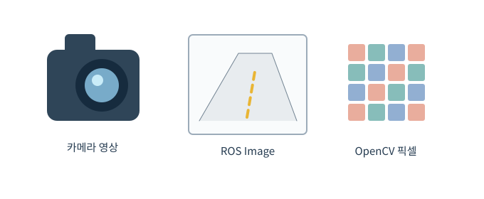

# Camera OpenCV compatibility overlay

카메라와 ROS 영상 패키지의 OpenCV 버전을 맞추는 호환성 워크스페이스입니다.

## 알고리즘과 역할

ROS 영상과 OpenCV 행렬을 변환하고, 카메라 영상의 압축·복원을 지원합니다. 시스템 OpenCV 버전에 맞춰 라이브러리를 빌드하는 호환성 워크스페이스이며 자체 주행 노드는 없습니다.



## References

학습·주행 알고리즘 논문 대신 사용하는 라이브러리의 원본을 참고합니다.

- [ROS perception: cv_bridge](https://github.com/ros-perception/vision_opencv/tree/humble/cv_bridge) — ROS/OpenCV 영상 변환.
- [ROS perception: image_transport_plugins](https://github.com/ros-perception/image_transport_plugins/tree/humble) — 압축 영상 전송 플러그인.

## 빌드와 환경 적용

The camera uses system OpenCV 4.8; ROS binaries used OpenCV 4.5, causing mixed libraries and camera aborts. This workspace rebuilds cv_bridge and image transport plugins against OpenCV 4.8, without replacing system packages.

Sources: ros-perception/vision_opencv and ros-perception/image_transport_plugins, humble branch. Git checkouts retain exact revisions.

```bash
source /opt/ros/humble/setup.bash
cd ~/2026-AutoRace/camera_compat_ws
colcon build --packages-select cv_bridge compressed_image_transport compressed_depth_image_transport theora_image_transport --cmake-args -DOpenCV_DIR=/usr/lib/cmake/opencv4 -DCMAKE_BUILD_TYPE=Release --parallel-workers 2
source install/setup.bash
```
Sensor and tensor_bringup setup files were regenerated with this overlay as an underlay. Re-source setup in existing terminals before restarting sensors.
