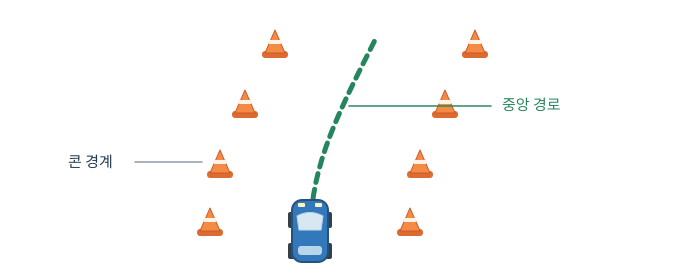

# cone_ws — LiDAR 콘 경로 생성·추종

LiDAR 콘 후보로 좌우 경계와 중앙 경로를 만들어 주행합니다. 자체 구현입니다.

## 입력·출력 토픽

토픽 이름·메시지 타입 펼쳐보기

| 방향 | 토픽 | 타입 | 내용 / 연결 |
| --- | --- | --- | --- |
| 입력 | `/scan` | `sensor_msgs/msg/LaserScan` | 콘 후보 거리값 |
| 입력 · TF | `/tf`, `/tf_static` | `tf2_msgs/msg/TFMessage` | 센서 변환·경로 메모리 좌표 변환 |
| 입력 | `/mission/lane` | `ackermann_msgs/msg/AckermannDriveStamped` | 탈출 시 차선 명령 |
| 입력 | `/mux/active_source` | `std_msgs/msg/String` | 실제 제어 주체 |
| 출력 | `/mission/cone/command_06` | `ackermann_msgs/msg/AckermannDriveStamped` | 콘 경로 명령 → mux |
| 출력 | `/cone_lane/exit_lane_active` | `std_msgs/msg/Bool` | 탈출 상태 → fusion 모드의 차선 인식 |
| 출력 | `/cone_lane/control_status` | `visualization_msgs/msg/Marker` | 제어 상태 표시·bringup 시작 검사 |
| 출력 · 관측 | `/cone_lane/roi_marker`, `/cone_lane/roi_points` | `visualization_msgs/msg/Marker` | ROI 경계·점 |
| 출력 · 관측 | `/cone_lane/clusters`, `/cone_lane/cone_centers` | `visualization_msgs/msg/MarkerArray` | 군집·후보 중심 |
| 출력 · 관측 | `/cone_lane/boundaries`, `/cone_lane/control_points` | `visualization_msgs/msg/MarkerArray` | 좌우 경계·제어 기준점 |
| 출력 · 관측 | `/cone_lane/center_path`, `/cone_lane/center_spot`, `/cone_lane/backup_path` | `visualization_msgs/msg/MarkerArray` | 중앙 경로·단면·보조 경로 |

[통합 실행](https://github.com/Minjea31/2026-AutoRace/blob/main/tensor_bringup/README.md) · [전체 토픽](../docs/architecture.md)
