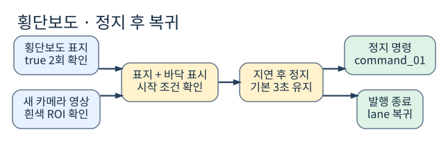

# crosswalk_ws — 흰색 바닥 감지 후 정지 및 재감지

표지판과 새 흰색 바닥 표시를 확인한 뒤 정지·재출발합니다.

## 입력·출력 토픽

토픽 이름·메시지 타입 펼쳐보기

| 방향 | 토픽 | 타입 | 내용 / 연결 |
| --- | --- | --- | --- |
| 입력 | `/yolo/crosswalk_sign` | `std_msgs/msg/Bool` | 횡단보도 표지 감지 |
| 입력 | `/camera/color/image_raw/compressed` | `sensor_msgs/msg/CompressedImage` | 새 흰색 바닥 표시 검사 |
| 입력 | `/mission/lane` | `ackermann_msgs/msg/AckermannDriveStamped` | 정지 중 유지할 차선 조향 |
| 출력 | `/mission/crosswalk/command_01` | `ackermann_msgs/msg/AckermannDriveStamped` | 정지 명령 → mux |
| 출력 | `/start_crosswalk` | `std_msgs/msg/Bool` | 첫 정지 시작 true → slow |
| 출력 · 관측 | `/crosswalk/white_roi/detected` | `std_msgs/msg/Bool` | 흰색 ROI 판정 |
| 출력 · 관측 | `/crosswalk/white_roi/ratio` | `std_msgs/msg/Float32` | 흰색 픽셀 비율 |
| 출력 · 관측 | `/crosswalk/white_roi/debug/compressed` | `sensor_msgs/msg/CompressedImage` | ROI 미리보기, 구독자가 있을 때 |

## References

- [1] OpenCV, [Thresholding Operations using inRange](https://docs.opencv.org/4.x/da/d97/tutorial_threshold_inRange.html)

[통합 실행](../tensor_bringup/README.md) · [전체 토픽](../docs/architecture.md)
