# 알고리즘 그림 모음

각 워크스페이스의 핵심 로직입니다. 세부 토픽과 참고문헌은 해당 README에서 펼쳐볼 수 있습니다.

## camera_compat_ws

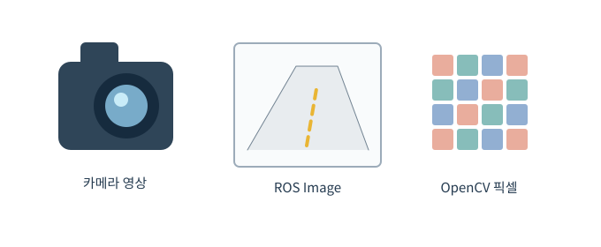

[README](../camera_compat_ws/README.md)

## sensor_ws

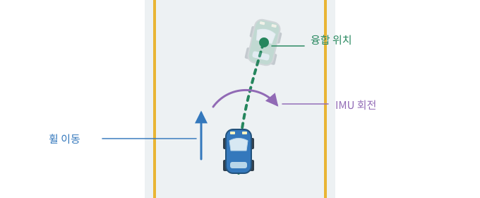

[README](../sensor_ws/README.md)

## yolo_ws

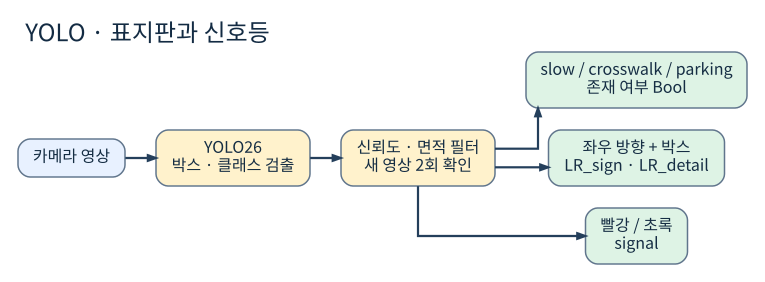

[README](../yolo_ws/README.md)

## lane_ws

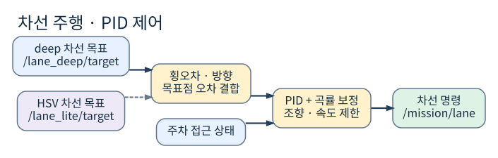

[README](../lane_ws/README.md)

## lane_fusion_ws

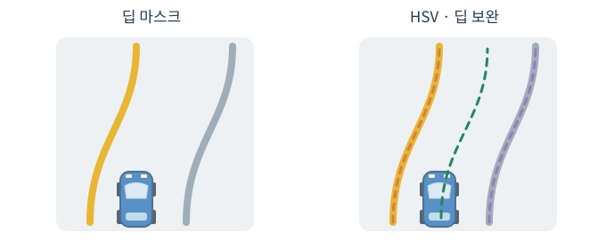

[README](../lane_fusion_ws/README.md)

## crosswalk_ws

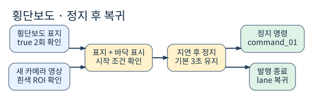

[README](../crosswalk_ws/README.md)

## signal_ws

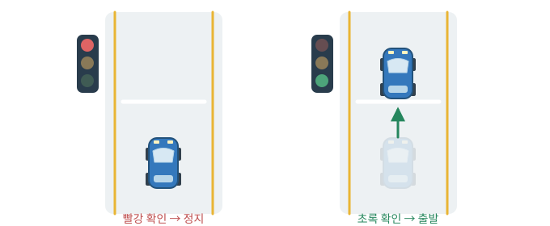

[README](../signal_ws/README.md)

## slow_ws

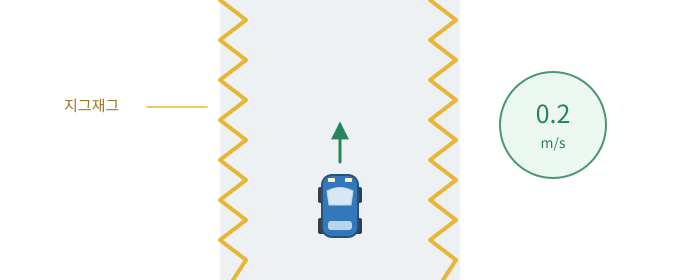

[README](../slow_ws/README.md)

## objavoid_ws

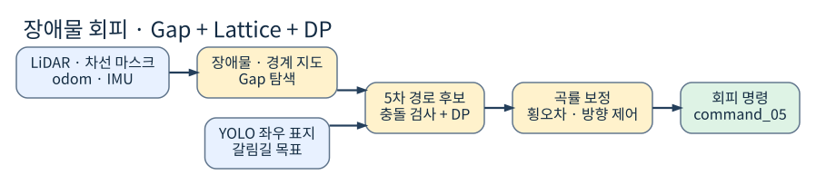

[README](../objavoid_ws/README.md)

## cone_ws

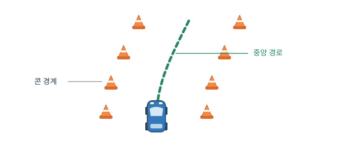

[README](../cone_ws/README.md)

## parking_ws

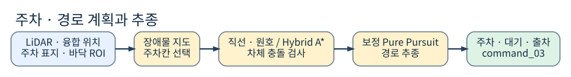

[README](../parking_ws/README.md)

## mux_ws

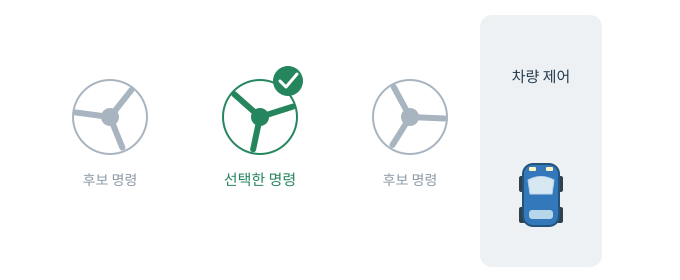

[README](../mux_ws/README.md)
