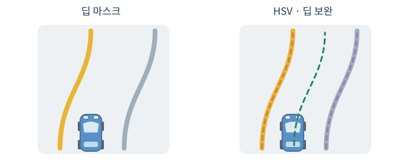

# lane_fusion_ws — Deep · Fusion 차선 인식

현재 deep 경로와 별도 fusion 경로를 모두 지원합니다.

실차 기준: `lane_mode:=deep lane_speed:=0.8`. fusion 알고리즘·노드·설정은 유지합니다.

## 입력·출력 토픽

토픽 이름·메시지 타입 펼쳐보기

### 현재 deep 모드

| 방향 / 노드 | 토픽 | 타입 | 내용 / 연결 |
| --- | --- | --- | --- |
| 입력 · deep_mask | `/camera/color/image_raw/compressed` | `sensor_msgs/msg/CompressedImage` | 카메라 영상 |
| 출력 · deep_mask → deep_lite·objavoid | `/lane_fusion/deep_mask` | `sensor_msgs/msg/Image` | `mono8`: 0=배경, 1=노랑, 2=흰색 |
| 입력 · deep_lite | `/odom` | `nav_msgs/msg/Odometry` | 이전 경로의 이동 보정 |
| 출력 · deep_lite | `/lane_deep/target` | `std_msgs/msg/Float32MultiArray` | 차선 기하·목표점 → lane_ws PID |
| 출력 · deep_lite | `/lane_deep/zigzag` | `std_msgs/msg/UInt8` | 0/1/2 지그재그 판정 → slow |
| 출력 · deep_lite | `/lane_deep/debug` | `sensor_msgs/msg/Image` | BEV 관측, `debug=true`일 때 |

### fusion 모드에서만 추가되는 연결

| 방향 / 노드 | 토픽 | 타입 | 내용 |
| --- | --- | --- | --- |
| 입력 · fusion 인식 | `/camera/color/image_raw/compressed` | `sensor_msgs/msg/CompressedImage` | HSV 인식 영상 |
| 입력 · fusion 인식 | `/lane_fusion/deep_mask` | `sensor_msgs/msg/Image` | 딥 경계 후보 |
| 입력 · fusion 인식 | `/odom`, `/imu` | `nav_msgs/msg/Odometry`, `sensor_msgs/msg/Imu` | 지연된 마스크·유지 경로 이동 보정 |
| 입력 · fusion 인식 | `/cone_lane/exit_lane_active` | `std_msgs/msg/Bool` | 콘 탈출 시 경계 역할 판단 보조 |
| 출력 · fusion 인식 → fusion PID | `/lane_fusion/target` | `std_msgs/msg/Float32MultiArray` | 융합 차선 기하 |
| 출력 · fusion 인식 | `/lane_fusion/yellow_boundary` | `nav_msgs/msg/Path` | 주차가 구독하는 노란 경계 |
| 출력 · fusion 인식 | `/lane_fusion/debug` | `sensor_msgs/msg/Image` | `debug=true` 관측 영상 |
| 입력 · fusion PID | `/parking_start` | `std_msgs/msg/Bool` | 주차 준비 정지 |
| 입력 · fusion PID | `/parking/ready` | `std_msgs/msg/Header` | 주차 준비 완료 |
| 출력 · fusion PID | `/mission/lane`, `/lane_fusion_pid/command` | `ackermann_msgs/msg/AckermannDriveStamped` | 차량 후보 / 관측 명령, 전자는 차량 출력 활성화 시 |
| 출력 · fusion PID | `/lane_fusion_pid/state` | `std_msgs/msg/Float32MultiArray` | 제어 상태 |

## References

- [1] O. Ronneberger, P. Fischer, T. Brox, **U-Net: Convolutional Networks for Biomedical Image Segmentation**, MICCAI, 2015. [논문](https://arxiv.org/abs/1505.04597)
- [2] A. Howard et al., **Searching for MobileNetV3**, ICCV, 2019. [논문](https://arxiv.org/abs/1905.02244)
- [3] OpenCV, [Contour Features](https://docs.opencv.org/4.x/dd/d49/tutorial_py_contour_features.html)

[통합 실행](../tensor_bringup/README.md) · [전체 토픽](../docs/architecture.md)
