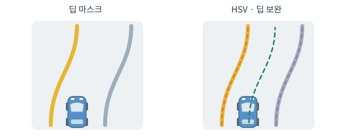

# autorace_lane_fusion

**간결한 단일 차로 인식 패키지**입니다. 카메라 영상에서 차선을 검출해 목표점(`/lane_fusion/target`)만 발행합니다. **조향·속도 제어는 하지 않습니다.** 제어는 별도 패키지 [`autorace_lane_fusion_pid`](../autorace_lane_fusion_pid/README.md)(오차 기반 PID)가 담당하며, 제어 파라미터는 이 패키지의 튜너에 나오지 않습니다.

## 빠른 실행 (시뮬, 인식 + PID 제어)

```bash
cd ~/2026-AutoRace/lane_ws          # 각자 clone 위치
source /opt/ros/humble/setup.bash
sudo apt install ros-humble-ackermann-msgs ros-humble-cv-bridge libopencv-dev libyaml-cpp-dev qtbase5-dev  # 없을 때만
PYTHONNOUSERSITE=1 colcon build --packages-select autorace_lane_fusion autorace_lane_fusion_pid --cmake-args -DCMAKE_BUILD_TYPE=Release

# 터미널 1: 시뮬
cd ~/2026-AutoRace && ./simul.sh
# 터미널 2: 인식 + PID 제어(/mission/lane) + PID 튜너 창
cd ~/2026-AutoRace && ./simul/lane.sh            # 차선 튜너 창도 함께: ./simul/lane.sh lane_gui:=true
# 터미널 3: /mission/lane -> /cmd_vel (mux 대신 시뮬로 바로 보낼 때)
cd ~/2026-AutoRace && ./simul/adapter.sh --no-gui --topic /mission/lane
```

- **차선 검출만** 필요하면 `ros2 launch autorace_lane_fusion lane_fusion.launch.py profile:=sim`(실차는 `profile:=real`)으로 실행하고 `/lane_fusion/target`만 구독합니다.
- 검출 결과 영상 확인(선택): `ros2 run rqt_image_view rqt_image_view /lane_fusion/debug`
- Qt5/rosbag2가 없는 PC에서는 튜너·eval이 자동으로 빠지고 `lane_fusion_node`만 빌드됩니다.

| 파일 | 역할 |
| --- | --- |
| `src/lane.cpp` | 설정 + 퓨전(후보 선택·추적·센터패스) + 시각화 |
| `src/candidates.cpp` | HSV 특징, 한 마스크(딥/HSV)에서의 좌우 경계 검출(lane_ws 방식) |
| `include/.../odometry.hpp`, `deep_latest.hpp` | odom 이력(두 촬영 시각 사이 이동량), 최신 딥 마스크 선택 |
| `src/node.cpp` | 카메라 → `/lane_fusion/target` (인식 전용, 주행 명령 없음) |
| `src/tuner.cpp` | Qt 인식 튜너 (제어 파라미터 없음) |
| `src/roi_view.cpp`, `src/bag.cpp` | 튜너용 ROI/BEV 드래그 화면, rosbag2 영상 리더 |
| `src/eval.cpp` | bag 일괄 평가 / 단일 이미지 확인 |

## 알고리즘



## 토픽

| 방향 | 토픽 | 내용 |
| --- | --- | --- |
| 구독 | `/camera/color/image_raw/compressed` | `sensor_msgs/CompressedImage` (JPEG) 전용. 토픽 이름만 `image_topic:=` 로 변경 가능 |
| 발행 | `/lane_fusion/target` | `Float32MultiArray` `[valid, lateral_m, heading_rad, lookahead_m, curvature, confidence, left_state, right_state, near_lateral_m, near_heading_rad, near_m]` (좌측 +, state 0=LOST 1=HELD 2=DETECTED). 앞 6개는 목표점(lookahead), `near_*`는 중앙 경로의 가장 가까운 점(BEV 맨 아래 쪽) 값 |
| 발행 | `/lane_fusion/debug` | BEV 경계·경로 영상 (구독자가 있을 때만 생성) |

## 설정


- launch와 튜너 모두 `profile`(sim / real)로 폴더를 고릅니다. 한쪽을 튜닝해도 다른 쪽은 바뀌지 않습니다. launch 기본값은 `profile:=sim`이고, `use_sim_time`은 profile에 따라 자동(sim=true, real=false)입니다. 제어 패키지 `autorace_lane_fusion_pid`도 같은 `profile` 인자를 씁니다.
- 튜너를 `--profile`로 열면 **Save YAML의 기본 저장 위치가 해당 프로필의 소스 파일**(`src/autorace_lane_fusion/config/<profile>/lane.yaml`)입니다. install 폴더로 열어도 소스 경로로 저장합니다. 창 제목에 현재 파일이 표시됩니다. 저장 후 다시 빌드해야 launch(설치 경로)에 반영됩니다. 실행 중인 노드에는 **Apply to running lane_fusion_node**로 바로 적용할 수 있습니다.
- `real/lane.yaml`의 **`bev_near_m`/`bev_far_m`는 자리표시값**입니다. 실차 폐루프 전에 실측해야 합니다.
- 코드 기본값(YAML 없이 실행할 때)은 시뮬 값과 같습니다(`lane_width_px` 240 등). 실차는 반드시 `--profile real`로 엽니다.

기존 GUI로 저장한 YAML(`lane:` / `sliding_window:`)도 Load YAML로 열 수 있습니다. ROI·BEV·차로 폭·HSV 색 임계값만 가져오고(HLS로 저장된 색은 무시) 나머지는 기본값을 씁니다.

**흰 실선 무시 (`white_max_length`, 실차 320 px):** 이 트랙에서 흰색은 점선만 차선 경계로 씁니다. BEV에서 긴 변이 이 값보다 긴 흰 덩어리(바깥 도로 가장자리, 옆 도로의 흰 실선)는 지우고, 점선 조각(약 170~220 px)만 남깁니다. 점선까지 사라지면 값을 올리고, 실선이 남으면 내립니다. 0이면 꺼집니다(시뮬 기본값).

**좌우 방향 검사 (`max_angle_deg`):** 횡단보도·정지선 같은 흰 조각을 거르는 검사입니다. 급커브에서는 노란 선 두 개도 BEV에서 30° 넘게 어긋나므로 **노랑+노랑 쌍에는 적용하지 않습니다**(폭 검사만). 노랑+흰색 쌍이 걸리면 흰 쪽을 버립니다.

튜닝 순서: **BEV(직선에서 두 선이 평행·세로) → `lane_width_px`(BEV를 바꾸면 반드시 다시 측정: 직선에서 두 선 사이 픽셀) → 색상(Binary 비교 화면) → `line_width_max`/`white_tophat`(반사광) → 윈도우 → 추적**.
`lane_width_px`가 실제보다 작으면 반대쪽 선이 폭 검사에서 탈락하고, 중앙선이 한쪽 선에서 `lane_width_px/2`만큼만 떨어진 곳(도로의 1/4 지점)에 생깁니다. 진단 창의 "차로 폭 학습값"과 BEV에서 두 선 사이 거리를 비교하세요.

## 빌드

```bash
cd ~/2026-AutoRace/lane_ws
source /opt/ros/humble/setup.bash
PYTHONNOUSERSITE=1 colcon build --packages-select autorace_lane_fusion --cmake-args -DCMAKE_BUILD_TYPE=Release
source install/setup.bash
colcon test --packages-select autorace_lane_fusion   # 합성 영상·마스크·odom 단위 테스트 30개
```

## 인식 튜너 GUI

launch에 `gui:=true`를 추가하거나(`./simul/lane.sh lane_gui:=true`) 아래처럼 직접 실행합니다. 이 창에는 **인식 파라미터만** 있습니다. PID 게인·속도는 별도 창 `lane_fusion_pid_tuner`에서 조절합니다.

## 검증 1 — bag (GUI)

```bash
cd ~/2026-AutoRace/lane_ws && source install/setup.bash
ros2 run autorace_lane_fusion lane_fusion_tuner --profile real \
  --bag /mnt/Ubuntu_Data/autorace_bags/lane_1104_ctrack/lane_20261104_192410
# 특정 프레임부터: --frame 1189   /  시뮬 값: --profile sim   /  임의 파일: --config 경로
```

Play/Pause, 이전/다음 프레임, 슬라이더 탐색, ROI·BEV 드래그, 슬라이더 조정이 기존 튜너와 같습니다. 아래 진단 창에서 좌/우 상태(DETECTED/HELD/LOST), 관측 윈도우 수, RMS, 탈락 이유, `/lane_fusion/target`으로 나가는 목표점·가까운 점 값을 확인합니다. 조정한 값은 **Save YAML**로 저장합니다(기본 위치 = 프로필 소스 파일).

## 검증 2 — bag 일괄 수치

```bash
CFG=$(ros2 pkg prefix autorace_lane_fusion)/share/autorace_lane_fusion/config
ros2 run autorace_lane_fusion lane_fusion_eval /mnt/Ubuntu_Data/autorace_bags/lane_1104_ctrack/lane_20261104_192410 \
  $CFG/real/lane.yaml /tmp/lane_fusion_eval --every 150
# frames.csv(프레임별 상태·횡오차) + frame_N.jpg(원본|특징|탐색|경로) + 요약 1줄
ros2 run autorace_lane_fusion lane_fusion_eval some_image.png $CFG/sim/lane.yaml out.png   # 이미지 한 장
```

## 검증 3 — 시뮬 폐루프

[`autorace_lane_fusion_pid` README](../autorace_lane_fusion_pid/README.md)의 실행 방법과 검증 결과를 참고합니다. `/mission/lane`은 한 노드만 발행해야 하므로 다른 lane 제어 노드와 동시에 실행하지 않습니다.

**3차선 흰 점선만 확인**(정차 차량 없는 맵, 터미널 1만 바꿈):
```bash
cd ~/2026-AutoRace && source simul/env.sh
sed 's/^  occupied: .*/  occupied: {}/' simul/src/limo_parking_sim/config/parking_map.yaml > /tmp/empty_map.yaml
./simul.sh --map /tmp/empty_map.yaml --spawn 8.0 0.94 3.14159   # 가운데 차로(양쪽 점선). 아래 0.42 / 위 1.46
```

## 검증 4 — 실차 (주행 출력 없이 먼저)

```bash
ros2 launch autorace_lane_fusion lane_fusion.launch.py profile:=real
# 다른 터미널: ros2 run rqt_image_view rqt_image_view /lane_fusion/debug
```

`real/lane.yaml`의 `bev_near_m`/`bev_far_m`는 실측 전 자리표시값입니다. 실차 제어는 `lane_ws/lane.sh real`(인식 + `autorace_lane_fusion_pid` `config/real/pid.yaml`)로 실행하며 아직 검증하지 않았습니다.

## 검증 결과 (2026-11-04, 이 PC)

- **횡단보도·정지선 안정화(2026-11-05)**, 2026-11-04 실차 bag `dark`/`fast`(`real/lane.yaml`, `white_max_width: 44`). 횡단보도 구간(dark 620–780·1540–1620, fast 410–580·1430–1560 프레임)에서 프레임 간 변화 횟수, 수정 전 → 후:

  | bag | \|near_heading\|>0.35 | \|heading\|>0.5 | near_lateral Δ>3 cm | near_heading Δ>0.2 | lateral Δ>3 cm |
  | --- | --- | --- | --- | --- | --- |
  | dark | 5 → 0 | 18 → 4 | 11 → 6 | 12 → 2 | 9 → 1 |
  | fast | 27 → 20 | 27 → 17 | 37 → 22 | 40 → 18 | 28 → 9 |

  bag 전체 lateral >5 cm 점프: dark 159→166, fast 164→151, slow 228→215, super_dark 65→70, lane_20261104_192410 683→650. 유효율은 같은 수준(lane_20261104_192410 끝의 카메라가 도로를 보지 않는 구간만 98.5→97.3 %). 남은 튐은 대부분 지그재그 노란 선·"천천히" 글자·라바콘 구간입니다.
- `white_max_width`는 **3차선 흰 점선 두께(실차 BEV 약 30 px)보다 커야** 합니다. 24로 두면 점선이 지워져 dark 3차선 구간(930–1140) 검출이 198→133 프레임으로 떨어졌고, 44에서 183(양쪽 경계 80→78)으로 회복했습니다. BEV를 바꾸면 점선·블록 두께를 다시 보고 그 사이 값으로 맞춥니다.

- 2026-11-04 bag `lane_20261104_192410` 5051프레임(`real/lane.yaml`): `lane_width_px` 240 → 470으로 양쪽 경계 5% → 48%, 흰 가로선 채택 제거. 직진·횡단보도·정지선·3차선 점선 구간은 양쪽 경계로 도로 중앙을 냄. 나머지 단일 경계 구간은 급커브·라바콘·손으로 든 장면.
- 이전 bag 3311프레임(수동 주행, 차선 밖·벽 장면 포함, 당시 BEV 기준): 유효 99.5%, 양쪽 경계 66%, CV 평균 7.6 ms. 같은 BEV를 준 legacy는 유효 80%·정지 23%·CV 19 ms. 유광 바닥의 넓은 반사광이 일부 남아 단일 경계 구간에서 횡오차가 튀는 프레임(>5 cm)이 약 5% 있습니다.
- (아래 시뮬 폐루프 2개 항목은 삭제된 Pure Pursuit 제어기로 확인한 과거 기록입니다. 현재 PID 결과는 `autorace_lane_fusion_pid` README 참고.)
- 시뮬 폐루프(headless, 별도 DDS 도메인): `track` 출발 → 우상단 코너 → 우측 직선 → 우하단 코너를 기본/`--lane-camera` 두 카메라 모두 주행. `signal` 출발 → 합류 S자 → 우측 지그재그 경계 → 코너 주행. 세 경우 모두 하단 **장애물 미션 구간의 정차 LIMO**에 막혀 정지(장애물 회피·갈림길은 이 패키지 범위 밖).
- 3차선 흰 점선(2026-11-04 추가 확인, 정차 차량 없는 맵): `track` 출발 → 우하단 코너 → 3차선 아래 차로를 노랑+점선 양쪽 DETECTED로 통과(반복 3회), 가운데 차로(양쪽 점선)·위 차로 출발도 점선 구간을 횡오차 0.01 m 이내로 주행. `signal` 출발·`--lane-camera`도 같은 구간까지 통과. 좌하단 코너 (0.7, 1.9)에서 정지하는 문제는 흰색 켬/끔과 무관하게 남아 있습니다.
- 실차 폐루프는 검증하지 않았습니다.
