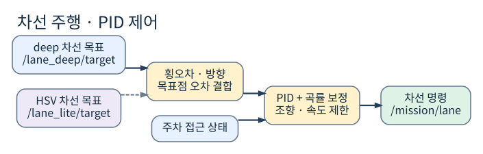

# lane_ws — 차선 인식과 차로 유지 제어

차선의 횡오차·방향·목표점으로 조향과 속도를 제어합니다.

현재 실차는 `/lane_deep/target`을 받습니다. HSV 입력은 별도 opencv 모드입니다.

## 입력·출력 토픽

토픽 이름·메시지 타입 펼쳐보기

| 방향 | 토픽 | 타입 | 내용 / 연결 |
| --- | --- | --- | --- |
| 입력 | `/lane_deep/target` | `std_msgs/msg/Float32MultiArray` | 중앙 경로·목표점·신뢰도 ← deep_lite |
| 입력 | `/odom` | `nav_msgs/msg/Odometry` | 주차 표지 이동 조건 검사, guard 활성화 시 |
| 입력 | `/yolo/parking_sign` | `std_msgs/msg/Bool` | 주차 접근 감속 시작 |
| 입력 | `/parking/approach_ready` | `std_msgs/msg/Header` | 접근 준비 확인 |
| 입력 | `/parking/control_state` | `std_msgs/msg/String` | 주차 제어 상태 |
| 입력 | `/parking/active` | `std_msgs/msg/Bool` | 주차 활성 상태 |
| 출력 | `/mission/lane` | `ackermann_msgs/msg/AckermannDriveStamped` | 기본 차선 명령 → mux, `enable_vehicle_output=true`일 때 |
| 출력 | `/parking/approach_start` | `std_msgs/msg/Header` | 접근 시작 시각 → parking·mux |
| 출력 | `/lane_pid/command` | `ackermann_msgs/msg/AckermannDriveStamped` | 계산한 명령 관측·튜닝 |
| 출력 | `/lane_pid/state` | `std_msgs/msg/Float32MultiArray` | 제어 오차·상태 관측 |

### HSV 인식 모드

| 방향 | 토픽 | 타입 |
| --- | --- | --- |
| 입력 | `/camera/color/image_raw/compressed`, `/odom` | `sensor_msgs/msg/CompressedImage`, `nav_msgs/msg/Odometry` |
| 출력 | `/lane_lite/target` | `std_msgs/msg/Float32MultiArray` |
| 관측 | `/lane_lite/debug` | `sensor_msgs/msg/Image` |

## References

- [1] K. J. Åström, R. M. Murray, **Feedback Systems**, 2008, Chapter 10: PID Control. [저자 공개 자료](https://www.cds.caltech.edu/~murray/FBS/PID_Control.html)
- [2] OpenCV, [HSV 범위 임계값](https://docs.opencv.org/4.x/da/d97/tutorial_threshold_inRange.html), [모폴로지 연산](https://docs.opencv.org/4.x/d9/d61/tutorial_py_morphological_ops.html)

[통합 실행](../tensor_bringup/README.md) · [전체 토픽](../docs/architecture.md)
