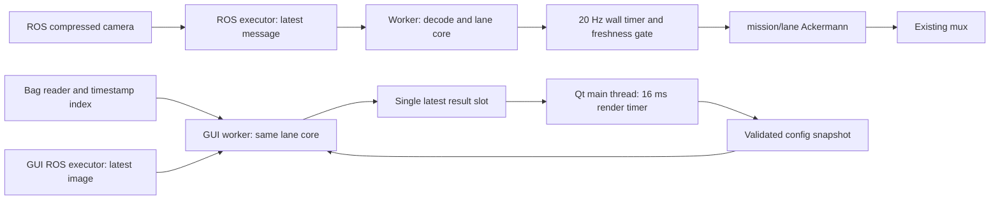

# 설계와 rqt 끊김 분석

## 저장소 분석과 변경 경계

2026-11-01에 `main`의 `5a9d6a835850d0ead37a66ce1520a16591698ce5`에서 로컬 `lane_ws` 브랜치를 생성했다. 로컬에 기존 clone이 없어서 새로 복제했고 최초 작업 트리는 깨끗했다. 기존 원격 브랜치는 main/mux_ws/parking_ws/simulation/yolo_ws였으며 lane_ws는 없었다. push/merge/원격 브랜치 생성은 하지 않았다.

README, docs/architecture.md, lane_ws/README.md, misson.md, simul/docs/MISSIONS.md, 센서·mux 인터페이스와 소스를 읽었다. lane_ws에는 README와 빈 src/init.txt만 있어 재사용할 구현이 없었다. 다른 팀 워크스페이스는 수정하지 않고, 기존 표준 메시지·mux·센서·미션 분담을 재사용했다. GUI·주행 노드·벤치마크는 같은 core.cpp를 사용한다.

차선 폭은 미션 문서에서 550mm, 일부 도면에서 500mm로 상충하므로 0.55m를 초기값으로 제공하고 설정으로 노출했다. 차로 선택과 갈림길 방향은 서로 다른 입력이다. LR_sign 미수신은 false가 아니다. 원본 Bag의 카메라 이외 센서는 사용하지 않는다.

## 실행 구조

Qt Widgets는 GUI 스레드에서만 사용한다. worker에서 QImage 데이터를 복사해 소유권을 확보한 후 최신 슬롯으로 넘기고, QPixmap 생성·크기 조정은 Qt 스레드에서 한다. 이는 [Qt 5.15 스레드 지침](https://doc.qt.io/archives/qt-5.15/threads-qobject.html)에 따른다. 영상 처리는 락 밖에서 수행하며 설정과 결과 포인터를 넘길 때만 짧게 잠근다. 세대 번호로 이전 소스/설정에서 계산한 결과가 새 화면을 덮지 못하게 한다.

실시간에서는 원본 전체 큐를 보존할 필요가 없으므로 BestEffort 깊이 1과 최신 슬롯을 쓴다. 분석용 Bag에서는 프레임을 버리지 않고 순차 재생하며, 역방향/탐색 시 reader.seek와 같은 timestamp 내 순번으로 정확한 프레임을 찾는다. Bag 인덱스는 시간과 Bool만 저장한다. 초기 스캔은 payload를 디스크에서 읽기는 하지만 누적 보관하지 않는다. 영상 메모리는 프레임 수에 비례해서 늘지 않는다. MCAP 등은 설치된 rosbag2 storage plugin에 의존하며 이번 실측 대상은 SQLite3이다.

Bag 시간을 wall clock과 혼합하지 않는다. 기록 시간으로 추적·인지 TTL을 계산하고 steady clock으로 재생을 예약한다. 실제 ROS 노드는 header의 ROS 시간과 수신 steady 시간을 모두 검사한다. GUI의 Apply 버튼은 기존 ROS 파라미터 서비스를 사용하며 커스텀 팀 토픽을 추가하지 않는다.

## rqt: 확인한 사실과 아직 검증되지 않은 가설

설치된 버전은 rqt_image_view 1.2.0, image_view 3.0.9, rviz2 11.2.22이다. 사용자가 경험한 끊김을 동일한 rqt 레이아웃·설정·부하로 재현하지 않았으므로 특정 원인으로 확정하지 않는다. Qt 자체가 느리다고 결론내릴 근거도 없다.

설치 버전에 대응하는 upstream [ImageView 소스](https://github.com/ros-visualization/rqt_image_view/blob/1.2.0/src/rqt_image_view/image_view.cpp)와 [RatioLayoutedFrame 소스](https://github.com/ros-visualization/rqt_image_view/blob/1.2.0/src/rqt_image_view/ratio_layouted_frame.cpp)를 확인했다. 화면 프레임은 setImage에서 mutex를 잡고 QImage를 복사하고 queued update를 보낸다. paintEvent 역시 같은 mutex를 잡고 그리며, smooth 옵션에서는 스케일 변환도 그 구간에서 수행한다. 이 구조에서는 복사·확대·paint 시간이 수신 경로와 경합할 가능성이 있다. 이것은 코드 기반 가능성 분석이며 실제 병목 측정 결과가 아니다.

확인할 후보는 다음과 같다.

- 해상도·smooth 확대에 따른 CPU 복사/색 변환/paint 비용 및 mutex 경합.
- 다른 rqt 플러그인과 같은 이벤트 루프를 공유할 때의 UI 부하.
- 원본과 compressed transport의 처리량 차이, QoS 불일치·재전송·발행 주기 차이.
- Bag의 원본 기록 주기 자체의 불균일함, 저장장치 I/O, 다른 프로세스 부하.

이번 Bag은 640×480 RGB8 3,311프레임/162.58초이며 평균 입력 빈도부터 약 20.4 FPS이다. 이 기록에서 모든 화면이 30 FPS로 움직일 수는 없다. 최초 정보 추출에 사용한 Python 사용자 환경에서는 NumPy ABI 충돌을 별도로 확인했지만, 이것을 기존 C++ rqt의 끊김 원인으로 연결하지 않는다.

새 GUI는 고정 표시 주기·최신 결과 슬롯·독립 계산·빠른 화면 스케일을 사용해 위 경합과 적체 가능성을 줄였다. 같은 Qt를 사용해도 구조가 다르다. image_view/RViz와의 정량적인 A/B 성능 우위는 이번 테스트로 주장하지 않는다. 추가 비교는 같은 Bag/시점/전송 형식/창 크기에서 각 앱을 하나씩 실행하고 CPU, frame age, paint 간격을 기록해야 한다.

## 재개 후 확인한 실시간 수신 병목

2026-11-02 계측에서 raw 영상은 생성기 157회 발행 대비 GUI 콜백 수신 27회였고, 후속 실행에서는 154회 대비 58회였다. JPEG는 146회 대비 140회였다. 수신과 처리 수는 일치했고, 표시 단계의 최신 슬롯 건너뛰기는 소수였다. 따라서 이 실행의 raw 저속은 GUI 처리 큐 적체로 설명되지 않으며 콜백 이전 전송·수신 경로를 추가 조사해야 한다. 실제 rqt의 이전 증상과 동일한 원인이라는 증거는 아니다. 기본 live 구독은 팀 계약의 compressed 토픽 하나로 정리했고, raw는 명시적으로 선택하며 Bag raw 영상은 직접 읽는다. 상세 수치는 [검증 보고서](validation.md)를 참고한다.

## 사각 ROI와 BEV 보정 분리

ROI 편집은 `roi_left/top/right/bottom` 사각 마스크를 원본 전체 좌표계에 적용한다. 실제 입력 마스크는 ROI와 기존 BEV 사다리꼴의 교집합이며, morphology 후에도 같은 마스크를 적용한다. BEV 높이는 `bev_top_y/bottom_y`로 분리했다. ROI 드래그 때문에 영상 크기·perspective transform·차선 폭의 좌표계가 변하지 않는다. ROI가 BEV 밖으로 가면 영상은 비어도 homography 자체는 유효하다.

기존 YAML에 BEV 높이가 없으면 load 시 기존 ROI 높이를 복사해 이전 보정을 보존한다. 새 YAML 저장은 모든 값을 명시한다. 주행 노드는 공통 파라미터 schema에서 새 값을 선언하고 GUI의 기존 atomic parameter 서비스로 적용한다.

`RoiView`는 Qt 메인 스레드에서 원본 이미지·노란 ROI 손잡이·파란 BEV 점선을 그린다. 마우스 좌표는 현재 영상 사각형을 기준으로 변환하므로 letterbox 여백, 창 리사이즈, 해상도 차이를 처리한다. 드래그와 spin box, YAML load가 동일한 설정 갱신 함수를 거친다. 이 함수는 설정을 검증하고 revision을 바꿔 worker가 최신 영상(일시정지 시 현재 프레임)을 재계산하게 한다. 렌더링 스레드에서 CV 계산을 수행하지 않는다.

## 구조 검증과 Center Path 추가

C++ 공통 코어에 연결 요소·두께·대비·연속성·곡률 검증, 전체 경계 쌍 선택, 시간 연계와 만료를 추가했다. 목표 행의 단일 x만 추적하던 구조에서 2차 Center Path 계수 전체를 추적한다. RANSAC·지그재그 검증, 기본 조향식, A/B 상태 기계, ROS 입력·출력은 재사용한다. 새 설정은 기존 schema를 통해 GUI·YAML·노드에 함께 반영한다.

Binary before/after와 비교 영상은 worker에서 만들고, Qt는 기존 최신 결과 슬롯에서 읽는다. Original의 ROI/BEV 편집 모드는 서로의 좌표를 변경하지 않는다. 양쪽 경계는 같은 청록색이며 Center/Target/횡오차를 구분한다. 정량 결과와 한계는 [추가 검증 보고서](path_validation.md)에 있다.

## 다차로 내부 결과

최신 다차로 확장은 [다차로 검증 기록](multilane_validation.md)에 있다. `Result::boundaries`와 `Result::lanes`는 외부 ROS 토픽 없이 GUI와 Bag 분석에 공유된다. 후보 경계 전체의 ID를 추적한 뒤 인접한 실제/가상 경계의 폭을 확인해 경로를 생성한다. 현재 `/mission/lane` 계산은 선택된 경로 하나를 사용한다. 장애물 회피 모듈과의 ID 교환·경로 선택 메시지는 후속 인터페이스 설계 대상이다.
