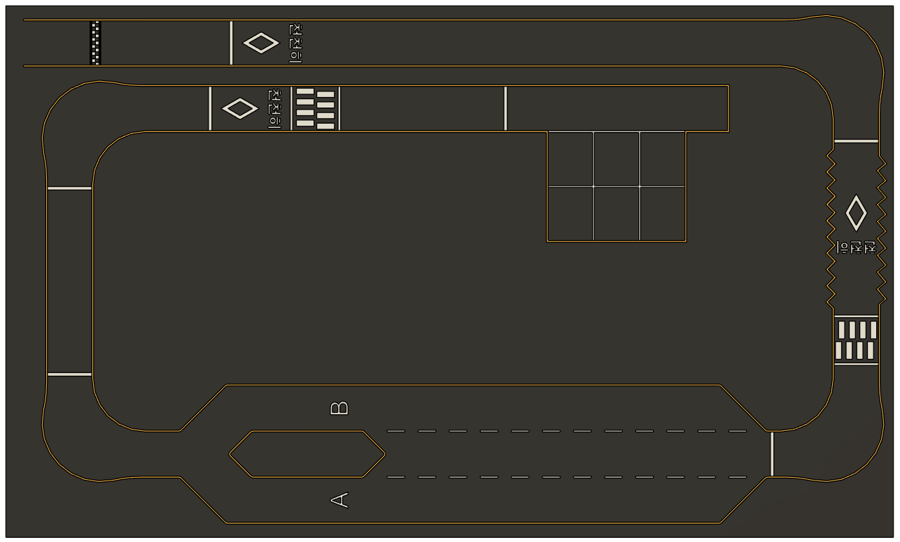
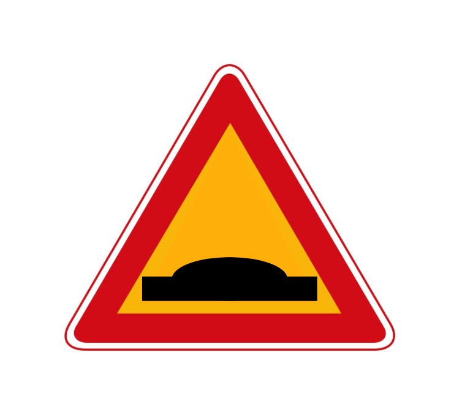
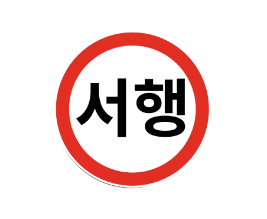
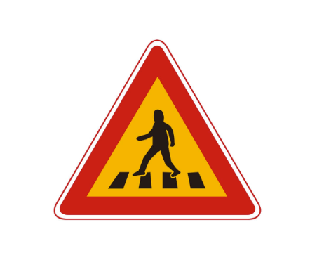
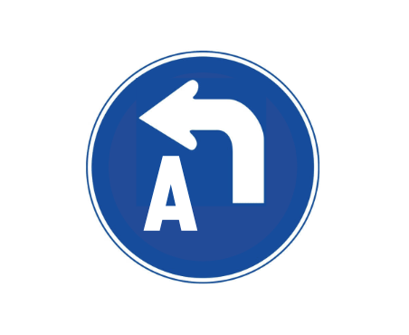
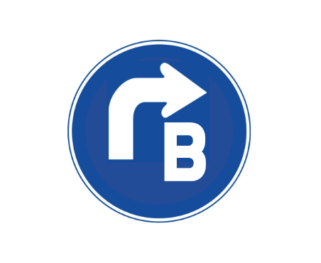
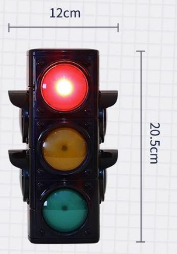
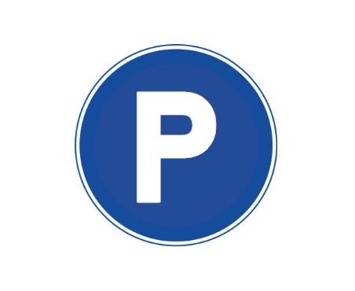

# 2026 AUTO RACE 미션 정리

`assets`의 자료 5개를 바탕으로, **출발선에서 시계방향으로 주행할 때 만나는 순서**에 따라 미션을 정리했습니다. 각 미션 제목을 누르면 세부 내용을 펼치거나 접을 수 있습니다.

배점과 판정은 **2026년 10월 8일 작성된 대회 규정집(초안_수정본)**을 기준으로 하고, 목적·센서·인식 방식은 **2026년 9월 28일 미션 상세 문서(초안)**를 함께 참고했습니다. 두 문서 모두 초안이며, 서로 다른 내용은 아래에 구분했습니다. YOLO는 상세 문서의 **권장 인식 방식**입니다.

## 참고 자료

| 자료 | 확인한 내용 |
| --- | --- |
| [대회 규정집](assets/Autorace2026_규정집.pdf) | 주행 순서, 8종 미션의 배점·판정·감점, 시설물 및 표지판 |
| [미션 상세 문서](assets/Autorace2026_mission_detail_draft.docx.pdf) | 미션 목적, 센서, 인식 방식, 수행 동작과 구성 |
| [트랙 치수 도면](assets/2026Track%20도면.pdf) | 전체 크기, 주행 구간, A/B 분기, 주차 구역 및 치수 |
| [트랙 지도 이미지](assets/KakaoTalk_20261023_032834501.png) | 출발선과 구간의 상대적 배치, 노면 표시 |
| [대회 포스터](assets/poster.jpg) | 대회 개요·일정 안내. 미션별 판정은 규정집 참고 |

## 트랙과 미션 순서

트랙은 **10m × 6m**이며, 좌측 상단 체커기 출발선에서 출발합니다. 지도에 시설물 위치가 모두 표시되어 있지는 않으므로, 아래 순서는 **규정집 4~5쪽의 레이아웃 설명과 미션 배치**를 함께 기준으로 했습니다.

**START → 방지턱 → 서행 유도선 → 보행자 정지 → 정적 장애물 회피 → 갈림길 A/B → 라바콘 회피 → 신호등 정지·발진 → T자 주차**

| 주행 순서 | 미션 | 규정집 번호 | 배점 | 관련 워크스페이스 |
| --- | --- | --- | --- | --- |
| 1 | 서행 구간 — 방지턱 | 미션 5 | 10점 | [slow_ws](slow_ws/) |
| 2 | 서행 유도선 통과 — 지그재그 차선 | 미션 6 | 15점 | [slow_ws](slow_ws/) |
| 3 | 보행자 표지판 정지 | 미션 3 | 10점 | [crosswalk_ws](crosswalk_ws/) |
| 4 | 정적 장애물 회피 — 3차선 | 미션 7 | 10점 | [objavoid_ws](objavoid_ws/) |
| 5 | 갈림길 경로 선택 — A/B | 미션 2 | 10점 | [lane_ws](lane_ws/) |
| 6 | 라바콘 회피 | 미션 8 | 15점 | [cone_ws](cone_ws/) |
| 7 | 신호등 정지·발진 — 방해 광고판 포함 | 미션 1 | 15점 | [signal_ws](signal_ws/) |
| 8 | T자 주차 | 미션 4 | 최대 15점 | [parking_ws](parking_ws/) |
| **합계** | **중복을 합친 8종** | | **100점** | |

### 자료 간 차이와 미정 사항

- 상세 초안의 **일반 신호등**과 **방해 광고판 옆 신호등**은 규정집에서 하나의 미션으로 통합되었습니다. 광고판 방해는 상시 적용되며, 별도 미션으로 중복 계산하지 않습니다.
- 상세 초안의 **차선 일부 Abnormal 구간**은 규정집의 **서행 유도선 통과**에 해당합니다. 정적 장애물 회피와 라바콘도 같은 미션끼리 한 번씩만 정리했습니다.
- 방지턱 서행 판정은 상세 초안의 '통과 시간 기준·기준 시간 미정' 대신, 규정집의 **기본 속도 절반 수준·최대 0.2m/s 이하·심사위원 육안 판정**을 적용했습니다.
- 규정집 본문은 차선 폭을 **550mm**로 안내하지만 치수 도면의 하단 3차선은 각 **500mm**로 표기합니다. 실제 구현에 사용할 치수는 원본 도면과 구분해서 확인해야 합니다.
- 서행 유도선·정적 장애물·라바콘 미션은 체크포인트 거리 비율로 부분 점수를 부여합니다. 세부 위치와 점수 반올림 방식은 제공 자료에 명시되어 있지 않습니다.

## 공통 주행·판정 기준

| 항목 | 규정집 기준 |
| --- | --- |
| 주행 기회·제한 시간 | 총 2회 중 좋은 점수로 평가. 1회 제한 시간은 10분이며, 초과 시 주행을 중단하고 획득 점수로 평가 |
| 순위 | 미션 점수 합산. 동점일 때 LapTime으로 순위 결정 |
| 기본 속도 | 0.3~0.4m/s 권고 |
| 서행 속도 | 최대 0.2m/s 이하. 방지턱 미션은 기본 주행 속도의 절반 수준으로 감속 |
| 물리적 판정 기준점 | 진입·통과·정지선 도달·시간 카운트는 **앞바퀴** 기준. 주차 점수는 별도의 **차체 네 모서리** 기준 |
| 차로 이탈 | 한쪽 측면의 앞·뒤 바퀴가 차선을 넘어 주행하면 1회당 **총점 −1점**. 이탈만으로 미션 실패·재출발 처리하지 않고 계속 주행 |
| 차로 이탈 예외 | **라바콘 구간은 차선 및 차로 이탈 감점을 적용하지 않음** |
| 시설물 충돌 | 규정집의 시설물 관련 선 밟음 또는 시설물 충돌은 1회당 **총점 −1점**. 정차 LIMO·표지판·신호등·광고판 등 포함 |
| 미션 Time-out | 진입하거나 정지 후 재출발해야 하는 상황에서 **15초 이내** 진입·발진하지 않으면 해당 미션 실패(0점). 부분 점수 미션의 체크포인트 규정은 각 항목 참고 |
| 시작·종료 위치 | 미션 시작은 구간의 하얀색 라인 앞부분. 시작선·종료선·체크포인트는 마스킹 테이프 등으로 구분 |
| 재출발 | 차로 이탈·시설물 충돌 외의 정지·진행 불가 등으로 미션 수행에 실패하면 해당 미션 시작 지점에서 재출발 |
| 미션 포기 | 포기 전 통과한 체크포인트의 부분 점수만 인정하고 잔여 점수는 0점. 다음 미션 시작 지점으로 이동하여 계속 주행 |

출처: [규정집 2~3쪽](assets/Autorace2026_규정집.pdf#page=2).

## 미션별 상세

<strong>1. 서행 구간 — 방지턱 · 10점</strong>

| 항목 | 내용 |
| --- | --- |
| 지도 위치 | 출발 후 상단 직선의 첫 서행 구간 |
| 목적 | 도로 환경을 모사한 표지판을 인식하고 감속하여 방지턱을 통과하는 능력 평가 |
| 센서 | 카메라 |
| 인식 방식 | YOLO 객체 인식 권장. 서행·방지턱 표지판과 노면의 감속 안내 인식 |
| 수행 내용 | 표지판 인식 → 기본 속도의 절반 수준으로 감속 → 서행하며 방지턱 통과 |
| 구성 | 방지턱, 진입 전 서행·방지턱 표지판, 마름모 노면 표시와 서행 문구 |
| 속도 기준 | 기본 주행 속도의 **1/2 수준**, **최대 0.2m/s 이하** |
| 판정 기준 | 심사위원이 육안으로 명확한 감속 여부 확인. 감속하여 통과하면 10점 |
| 실패 조건 | 감속 없이 통과하거나 육안상 속도 차이가 없는 경우, 방지턱에서 멈춰 통과하지 못한 경우 |
| 시설물 참고 | 방지턱은 차량 지상고 약 24mm를 초과하지 않도록 설치 |
| 관련 표지판 | **방지턱 주의**, **서행**. 아래 사진 참고 |

**수행 흐름:** 표지판·노면 표시 인식 → 감속 → 방지턱 통과.

**표지판 사진**

| 방지턱 주의 | 서행 |
| :---: | :---: |
|  |  |

출처: [규정집 8쪽](assets/Autorace2026_규정집.pdf#page=8), [시설물 안내 12·14쪽](assets/Autorace2026_규정집.pdf#page=12), [상세 초안 4쪽](assets/Autorace2026_mission_detail_draft.docx.pdf#page=4).

<strong>2. 서행 유도선 통과 — 지그재그 차선 · 15점</strong>

| 항목 | 내용 |
| --- | --- |
| 지도 위치 | 상단 우측 코너 이후 오른쪽 세로 구간 |
| 목적 | 비정상적인 차선 모양에서도 진행 방향을 유지하며 주행하는 능력 평가 |
| 센서 | 카메라 |
| 인식 방식 | 차선 인식 기반으로 **구간 진입 직전 헤딩(차량 진행 방향)** 유지 |
| 수행 내용 | 서행 유도선 구간 진입 → 직전 헤딩을 유지하며 서행 → 구간 통과 |
| 구성 | 지그재그 형태의 서행 유도선, 마름모·서행 노면 표시, 거리별 체크포인트 |
| 규격 | 규정집 기준 곡선 반경 **0.6m 이상**, 각도 **90°**, 폭 **450~690mm**, 구간 길이 **1,677mm** |
| 판정 기준 | 전체 구간 통과 시 15점. 실패하더라도 최종 도달·통과한 체크포인트의 거리 비율에 따라 부분 점수 |
| 차로 이탈 | 일반 차로 이탈 기준 적용. 1회당 총점 −1점이며 이탈만으로 실패·재출발하지 않음 |
| 미정 사항 | 세부 체크포인트 위치는 추후 트랙 노면에 지정 |
| 관련 표지판 | 이 미션만을 위한 별도 표지판 이미지는 없음. **지그재그 차선·마름모·서행 문구**가 지도에 표시됨 |

**수행 흐름:** 진입 직전 진행 방향 확인 → 헤딩 유지 → 서행 → 체크포인트 및 종료 구간 통과.

출처: [규정집 9쪽](assets/Autorace2026_규정집.pdf#page=9), [상세 초안 5쪽의 Abnormal 구간](assets/Autorace2026_mission_detail_draft.docx.pdf#page=5).

<strong>3. 보행자 표지판 정지 · 10점</strong>

| 항목 | 내용 |
| --- | --- |
| 지도 위치 | 오른쪽 서행 유도선 이후 횡단보도 |
| 목적 | 보행자 표지판 인식에 따라 정지하고 정해진 시간 뒤 재출발하는 능력 평가 |
| 센서 | 카메라 |
| 인식 방식 | YOLO 객체 인식 권장. 보행자 표지판을 인식하고 횡단보도 정지선 위치 확인 |
| 수행 내용 | 표지판 인식 → 횡단보도 정지선에서 완전정지 → 3초 이상 대기 → 재출발 |
| 구성 | 보행자 표지판, 횡단보도, 정지선. 표지 판면은 **10cm 이상**, 지주 포함 |
| 정지 기준 | 앞바퀴 기준 정지선 오차 **±5cm** 이내에서 **속도 0** |
| 대기·발진 기준 | **완전정지가 확인된 시점부터** 3초 이상 대기하고, 완전정지 후 **15초 이내** 발진 |
| 판정 기준 | 정지 위치·완전정지·대기 시간·재출발 조건을 모두 만족하면 10점 |
| 실패 조건 | 정지 미이행, 정지 오차 초과, 3초 미만 대기 후 출발, 15초 초과 미출발 |
| 관련 표지판 | 빨간 삼각 테두리·노란 바탕에 횡단보도를 건너는 사람이 그려진 **보행자 표지판** |

**수행 흐름:** 보행자 표지판 인식 → 정지선 ±5cm에 완전정지 → 정지 확인 시점부터 3초 이상 대기 → 15초 이내 발진.

**표지판 사진**

출처: [규정집 7쪽](assets/Autorace2026_규정집.pdf#page=7), [표지판 안내 12쪽](assets/Autorace2026_규정집.pdf#page=12), [상세 초안 4쪽](assets/Autorace2026_mission_detail_draft.docx.pdf#page=4).

<strong>4. 정적 장애물 회피 — 3차선 · 10점</strong>

| 항목 | 내용 |
| --- | --- |
| 지도 위치 | 하단 3차선 구간, A/B 갈림길 이전 |
| 목적 | 정차 차량을 감지하고 차선을 변경하여 회피하는 능력 평가 |
| 센서 | 라이다 |
| 인식 방식 | 라이다 거리 기반 장애물 감지·회피 |
| 수행 내용 | 진행 차로의 정차 LIMO 감지 → 다른 차선으로 변경 → 장애물 회피 → 주행 유지 |
| 구성 | 3차선 도로, 정차 **LIMO 7대**, 거리별 체크포인트 |
| 판정 기준 | 장애물을 안전하게 회피해 전체 구간을 통과하면 10점. 최종 안전 통과 체크포인트의 거리 비율에 따라 부분 점수 |
| 충돌 감점 | 정차 LIMO 접촉 시 1회당 **총점 −1점** |
| 차로 이탈 | 가장자리 차로 이탈은 공통 기준에 따라 총점 −1점. 미션 수행을 위한 차선 변경과 구분 |
| 실패 조건 | **15초 이내 미진입**. 정지·진행 불가 등은 공통 재출발·부분 점수 기준 참고 |
| 관련 표지판 | 전용 표지판은 제시되지 않음. 핵심 인지 대상은 **정차 LIMO와 주행 가능 공간** |

**수행 흐름:** 정차 차량 감지 → 회피할 차선 선택 → 차선 변경 → 체크포인트 통과 → 주행 유지.

출처: [규정집 6·9쪽](assets/Autorace2026_규정집.pdf#page=9), [시설물 안내 14쪽](assets/Autorace2026_규정집.pdf#page=14), [상세 초안 5쪽](assets/Autorace2026_mission_detail_draft.docx.pdf#page=5).

<strong>5. 갈림길 경로 선택 — A/B · 10점</strong>

| 항목 | 내용 |
| --- | --- |
| 지도 위치 | 하단 3차선 구간 이후, 왼쪽의 A/B 분기 |
| 목적 | 표지판을 인식하여 실행 중 올바른 경로를 선택하는 능력 평가 |
| 센서 | 카메라 |
| 인식 방식 | YOLO 객체 인식 권장. 좌측 A·우측 B 표지판 판별 |
| 수행 내용 | 주행 중 표지판 인식 → 지시 방향 선택 → 해당 경로로 진입 |
| 구성 | 갈림길, 좌측 **A** 또는 우측 **B** 표지판. 인쇄 마커 등으로 설치 가능 |
| 표지판 운영 | 매 시도마다 **코드가 이미 실행 중인 상태에서 무작위로 교체·설치**. 방향별 사전 선택 없이 하나의 코드로 대응 |
| 판정 기준 | 지시된 방향의 경로에 진입하면 10점 |
| 실패 조건 | 지시와 반대 경로 진입, **15초 이내 미진입** |
| 관련 표지판 | 파란 원형에 흰색 좌회전 화살표와 **A**, 또는 우회전 화살표와 **B** |

**수행 흐름:** 표지판 인식 → A/좌 또는 B/우 결정 → 해당 분기 진입.

**구현 담당:** `yolo_ws`가 `/yolo/LR_sign` (`std_msgs/msg/Bool`)으로 `false=좌/A`, `true=우/B`를 보내고, `lane_ws`가 경로 선택·속도·조향·구간 완료를 처리합니다. 기본 주행 명령은 `/mission/lane`으로 발행합니다.

**표지판 사진**

| A — 좌측 경로 | B — 우측 경로 |
| :---: | :---: |
|  |  |

출처: [규정집 5·7쪽](assets/Autorace2026_규정집.pdf#page=7), [표지판 안내 12쪽](assets/Autorace2026_규정집.pdf#page=12), [상세 초안 3쪽](assets/Autorace2026_mission_detail_draft.docx.pdf#page=3).

<strong>6. 라바콘 회피 · 15점</strong>

| 항목 | 내용 |
| --- | --- |
| 지도 위치 | A/B 갈림길 이후. 지도에 콘 개별 위치는 미표시이며, 순서는 규정집 배치 설명 기준 |
| 목적 | 연속 배치된 장애물을 감지하고 회피하는 능력 평가 |
| 센서 | 라이다 |
| 인식 방식 | 라이다 거리 기반 장애물 감지·회피 |
| 수행 내용 | 임의 배치된 라바콘 감지 → 라바콘의 **안쪽 경로**를 따라 회피 → 구간 통과 |
| 구성 | 다수의 라바콘, 콘 바닥의 원래 위치를 나타내는 마스킹 테이프, 거리별 체크포인트 |
| 시설물 조건 | 라바콘은 **2D LiDAR 스캔 평면에서 감지될 수 있는 높이**로 설치 |
| 판정 기준 | 전체 구간 통과 시 15점. 최종 통과한 체크포인트의 거리 비율에 따라 부분 점수 |
| 콘 감점 | 라바콘이 **전도되거나 바닥 표식을 완전히 벗어나면 개당 총점 −1점** |
| 차로 이탈 예외 | 차선이 그려져 있어도 차선으로 판정하지 않으며 **차로 이탈 감점 없음** |
| 미정 사항 | 라바콘 수량·간격의 확정 수치는 제공 자료에 없음 |
| 관련 표지판 | 전용 표지판은 제시되지 않음. 핵심 인지 대상은 **라바콘** |

**수행 흐름:** 라바콘 감지 → 안쪽 통과 경로 선택 → 연속 회피 → 체크포인트 및 종료 구간 통과.

출처: [규정집 9쪽](assets/Autorace2026_규정집.pdf#page=9), [시설물 안내 14쪽](assets/Autorace2026_규정집.pdf#page=14), [상세 초안 6쪽](assets/Autorace2026_mission_detail_draft.docx.pdf#page=6).

<strong>7. 신호등 정지·발진 — 방해 광고판 포함 · 15점</strong>

| 항목 | 내용 |
| --- | --- |
| 지도 위치 | 라바콘 이후, 주차 구역 이전의 안쪽 상단 횡단보도 구간 |
| 목적 | 광고 영상의 방해 속에서도 신호를 인식해 정지·발진하는 능력 평가 |
| 센서 | 카메라 |
| 인식 방식 | YOLO 객체 인식 권장. 실제 신호등의 **적색·황색·녹색**을 인식하고 광고판 영상과 구분 |
| 수행 내용 | 신호 상태 인식 → 정지선에서 완전정지 → 녹색 발진 신호 인지 후 출발 |
| 구성 | 3색 신호등, 정지선·횡단보도, 신호등 옆 **상시 방해 광고판 모니터** |
| 신호등 조건 | 판독부 최소 크기 **8~10cm 이상**, 차량 카메라 화각 **약 71°** 안에 설치 |
| 정지 기준 | 앞바퀴 기준 정지선 오차 **±5cm** 이내 완전정지 |
| 발진 기준 | **녹색 신호 인지 후 15초 이내** 발진 |
| 판정 기준 | 신호에 맞는 정지와 녹색 전환 후 발진 조건을 만족하면 15점 |
| 실패 조건 | 정지 오차 초과, 정지 미이행, 15초 초과 미출발 |
| 차로 이탈 | 실패로 처리하지 않고 공통 차로 이탈 감점 후 계속 주행 |
| 관련 인지 대상 | **적·황·녹 3색 신호등**과 방해 광고판. 일반 신호등·광고판 신호등을 하나의 미션으로 통합 |

**수행 흐름:** 신호등과 광고 화면 구분 → 신호 상태 판단 → 정지선 ±5cm에 완전정지 → 녹색 인지 후 15초 이내 출발.

황색도 인식 대상이지만, 황색에서의 개별 동작·점수 조건은 제공 규정집에 별도로 명시되어 있지 않습니다.

**신호등 사진**

출처: [규정집 7쪽](assets/Autorace2026_규정집.pdf#page=7), [신호등 안내 11쪽](assets/Autorace2026_규정집.pdf#page=11), [상세 초안 3·5쪽](assets/Autorace2026_mission_detail_draft.docx.pdf#page=3).

<strong>8. T자 주차 · 15 / 7 / 0점</strong>

| 항목 | 내용 |
| --- | --- |
| 지도 위치 | 신호등 구간 이후, 안쪽 상단 우측의 주차 구역 |
| 목적 | 지정된 주차 구역을 인식하고 차체를 구역 안에 넣는 능력 평가 |
| 센서 | 카메라·라이다 |
| 인식 방식 | 카메라와 라이다를 활용한 주차 구역 및 양옆 차량 인식. 세부 알고리즘은 자료에 미지정 |
| 수행 내용 | 주차 구역 인식 → 진입 경로 결정 → 지정된 사각형 구역 안에 주차 |
| 구성 | 사각형 주차 구역·주차선, 주차 표지판, 주차 구역 양옆 정차 LIMO **최소 2대** |
| 진입 방향 | **전면·후면 주차 모두 허용** |
| 점수 판정 기준점 | 바퀴가 아닌 **차체 네 모서리** |
| 시설물 접촉 | 양옆 LIMO 등 시설물 접촉은 공통 시설물 충돌 감점 적용 |
| 관련 표지판 | 파란 원형에 흰색 **P**가 있는 주차 표지판 |

| 판정 | 차체 모서리 상태 | 점수 |
| --- | --- | --- |
| 성공 | 네 모서리가 **모두 주차구역 라인 안쪽**에 위치 | **15점** |
| 부분 성공 | **1곳만** 라인에 걸치거나 구역 밖으로 벗어남 | **7점** |
| 실패 | **2곳 이상** 라인에 걸치거나 구역 밖으로 벗어남 | **0점** |

**수행 흐름:** P 표지판·주차 구역 인식 → 양옆 차량 확인 → 전면 또는 후면 진입 → 네 모서리 위치를 기준으로 주차 완료.

주차 후 의무 정차 시간이나 출차 완료 조건은 제공 자료에 별도로 명시되어 있지 않습니다.

**표지판 사진**

출처: [규정집 8쪽](assets/Autorace2026_규정집.pdf#page=8), [주차 표지판·시설물 안내 13~14쪽](assets/Autorace2026_규정집.pdf#page=13), [상세 초안 4쪽](assets/Autorace2026_mission_detail_draft.docx.pdf#page=4).

## 표지판과 인지 대상

아래 이미지는 새로 그린 그림이 아니라 **규정집 11~13쪽에 들어 있는 원본 이미지**를 추출한 것입니다. 추출 파일은 [`assets/signs`](assets/signs/)에 있습니다. 미션 번호는 위 문서의 **주행 순서**를 뜻합니다.

| 원본 이미지 | 표지판·대상 | 구분할 특징 | 연결 미션과 의미 |
| --- | --- | --- | --- |
|  | **방지턱 주의** | 빨간 삼각 테두리, 노란 바탕, 검은 방지턱 모양 | **1번 방지턱** — 전방 방지턱 인지 및 감속 |
|  | **서행** | 빨간 원형 테두리, 흰 바탕, 검은색 `서행` 글자 | **1번 방지턱** — 감속 안내. 지도에는 다른 서행 구간에도 노면 문구가 표시됨 |
|  | **보행자** | 빨간 삼각 테두리, 노란 바탕, 사람과 횡단보도 그림 | **3번 보행자 정지** — 정지선에서 정지 후 3초 이상 대기 |
|  | **갈림길 A / 좌측** | 파란 원형, 흰색 좌회전 화살표와 `A` | **5번 갈림길** — A·좌측 경로로 진입 |
|  | **갈림길 B / 우측** | 파란 원형, 흰색 우회전 화살표와 `B` | **5번 갈림길** — B·우측 경로로 진입 |
|  | **3색 신호등** | 세로로 배열된 적색·황색·녹색 등화. 표지판이 아닌 신호 장치 | **7번 신호등** — 광고 화면과 구분하여 정지·발진 |
|  | **주차 P** | 파란 원형, 흰색 `P` | **8번 T자 주차** — 주차 미션 구역 안내 |

서행 유도선은 **노면의 지그재그 차선**, 정적 장애물 회피는 **정차 LIMO**, 라바콘 회피는 **라바콘**을 인지 대상으로 합니다. 이 세 미션의 전용 표지판 이미지는 제공 자료에 없습니다. 마름모와 `천천히` 등의 노면 표시는 위 트랙 지도에서 확인할 수 있습니다.

출처: [규정집 신호등·표지판 안내 11~13쪽](assets/Autorace2026_규정집.pdf#page=11).
