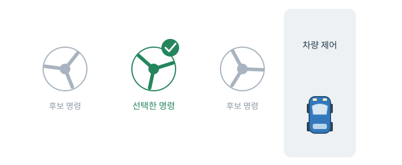

# mux_ws

유효한 미션 명령 하나를 골라 차량 명령으로 변환합니다. 자체 우선순위 로직입니다.

## 입력·출력 토픽

토픽 이름·메시지 타입 펼쳐보기

| 방향 | 토픽 | 타입 | 내용 |
| --- | --- | --- | --- |
| 입력 | `/mission/crosswalk/command_01` | `ackermann_msgs/msg/AckermannDriveStamped` | 횡단보도 후보 |
| 입력 | `/mission/signal/command_02` | `ackermann_msgs/msg/AckermannDriveStamped` | 신호등 후보 |
| 입력 | `/mission/parking/command_03` | `ackermann_msgs/msg/AckermannDriveStamped` | 주차 후보 |
| 입력 | `/mission/slow/command_04` | `ackermann_msgs/msg/AckermannDriveStamped` | 서행 후보 |
| 입력 | `/mission/objavoid/command_05` | `ackermann_msgs/msg/AckermannDriveStamped` | 장애물 회피 후보 |
| 입력 | `/mission/cone/command_06` | `ackermann_msgs/msg/AckermannDriveStamped` | 콘 회피 후보 |
| 입력 | `/mission/lane` | `ackermann_msgs/msg/AckermannDriveStamped` | 기본 차선 후보 |
| 입력 | `/parking/control_state` | `std_msgs/msg/String` | 주차 제어 상태 |
| 입력 | `/parking/approach_start` | `std_msgs/msg/Header` | 주차 접근 시작 |
| 입력 | `/parking/lane_handoff` | `std_msgs/msg/Header` | 출차 후 lane 인계 |
| 출력 | `/cmd_vel` | `geometry_msgs/msg/Twist` | 최종 차량 속도·각속도 → LIMO base |
| 출력 | `/mux/active_source` | `std_msgs/msg/String` | 현재 선택한 제어 주체 → 미션·웹 |

[통합 실행](https://github.com/Minjea31/2026-AutoRace/blob/main/tensor_bringup/README.md) · [전체 토픽](../docs/architecture.md)
