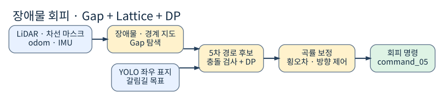

# objavoid_ws — 장애물 회피·갈림길 주행

차량이 통과할 공간과 경로를 찾아 장애물·갈림길을 주행합니다.

실차 기준: C++ · car06 · normal. 기본 단독 명령 `/objavoid_v3/cmd`는 통합 실행에서 command_05로 바뀝니다.

## 입력·출력 토픽

토픽 이름·메시지 타입 펼쳐보기

| 방향 | 토픽 | 타입 | 내용 / 연결 |
| --- | --- | --- | --- |
| 입력 | `/scan` | `sensor_msgs/msg/LaserScan` | 장애물·통과 공간 관측 |
| 입력 | `/odom` | `nav_msgs/msg/Odometry` | 차량 이동 |
| 입력 | `/imu` | `sensor_msgs/msg/Imu` | 방향 적분, 현재 car06의 `yaw_source=imu` |
| 입력 | `/lane_fusion/deep_mask` | `sensor_msgs/msg/Image` | 노란 경계·흰색 시작 조건, 차선 사용 시 |
| 입력 | `/yolo/LR_sign` | `std_msgs/msg/Bool` | false=왼쪽/A, true=오른쪽/B |
| 입력 | `/yolo/LR_detail` | `std_msgs/msg/Float32MultiArray` | 확정 표지판 박스·촬영 시각 |
| 입력 | `/limo_status` | `limo_msgs/msg/LimoStatus` | 수동/자동 제어 모드 |
| 입력 | `/mux/active_source` | `std_msgs/msg/String` | 실제 제어 주체 |
| 입력 | `/slow/mission_active` | `std_msgs/msg/Bool` | 서행 중 시작 차단 |
| 입력 | `/mission/slow/command_04` | `ackermann_msgs/msg/AckermannDriveStamped` | 최근 서행 명령 확인 |
| 입력 · 외부 | `/objavoid_v3/activate` | `std_msgs/msg/Bool` | 수동 시작/중지 |
| 입력 · 조건부 | `/mission/lane` | `ackermann_msgs/msg/AckermannDriveStamped` | `fork_shape=true`에서만 구독; 현재 car06은 false |
| 출력 · 통합 실행 | `/mission/objavoid/command_05` | `ackermann_msgs/msg/AckermannDriveStamped` | 회피 명령 → mux |
| 출력 · 상태 | `/objavoid_v3/active`, `/objavoid_v3/done`, `/objavoid_v3/entrance_armed`, `/objavoid_v3/has_control` | `std_msgs/msg/Bool` | 활성·완료·입구 준비·제어 소유 |
| 출력 · 상태 | `/objavoid_v3/state` | `std_msgs/msg/String` | 미션 상태·진단 |
| 출력 · 관측 | `/objavoid_v3/markers` | `visualization_msgs/msg/MarkerArray` | 장애물·후보·경로 표시 |
| 출력 · 관측 | `/objavoid_v3/path` | `nav_msgs/msg/Path` | 선택 경로 |

## References

- [1] M. Werling, J. Ziegler, S. Kammel, S. Thrun, **Optimal Trajectory Generation for Dynamic Street Scenarios in a Frenet Frame**, ICRA, 2010. [KIT 서지](https://publikationen.bibliothek.kit.edu/1000138243), [DOI](https://doi.org/10.1109/ROBOT.2010.5509799)

[통합 실행](../tensor_bringup/README.md) · [전체 토픽](../docs/architecture.md)
