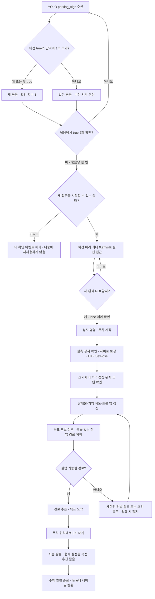

# 106 플랫폼 주차 로직

2026-11-19 기준. `parking_ws/src/autorace_parking` 코드와 `config/parking_real.yaml`의 실차 설정을 설명합니다. 이번 변경은 주차 표지 입력을 **1초 간격의 감지 묶음**으로 받는 부분입니다. 경로 계획·EKF·차량 제어 설정은 유지합니다.

## 1. 전체 흐름



## 2. YOLO 신호를 한 묶음으로 받는 방법

입력은 `/yolo/parking_sign`의 `std_msgs/Bool`입니다. YOLO는 표지가 계속 확인되면 `true`를 반복 발행합니다. YOLO 설정 주기는 10Hz이며 실제 발행 주기는 추론·영상 수신 상태에 따라 달라질 수 있습니다. YOLO 내부의 프레임 확인과 parking 노드가 입력 신호를 2회 확인하는 것은 별도 단계입니다.

- **마지막 `true`와 간격 ≤ 1초**: 같은 묶음입니다.
- **마지막 `true`와 간격 > 1초**: 새 묶음의 첫 번째 신호입니다.
- 묶음에서 `true` 2회가 들어오면 확인 이벤트를 한 번 발생시킵니다.
- 이미 확인한 묶음의 `true`는 무시하되 마지막 수신 시각은 계속 갱신합니다.
- `false`는 마지막 `true` 시각과 확인 횟수를 바꾸지 않습니다.
- 메시지에는 시각 헤더가 없으므로 수신 측 단조 증가 시계를 사용합니다.

예시:

| 수신 시각 | 입력 | 처리 |
|---|---|---|
| 0.0초 | true | 묶음 A의 1회째 |
| 0.4초 | false | 변화 없음 |
| 0.8초 | true | 묶음 A 확인 완료 → 시작 조건 검사 |
| 0.9초~5.0초 | true 반복 | 묶음 A이므로 무시, 마지막 true 시각은 계속 갱신 |
| 6.1초 | true | 5.0초 이후 1초 초과 공백 → 묶음 B의 1회째 |
| 6.2초 | true | 묶음 B 확인 완료 → 시작 조건 검사 |

고정된 **정지 후 5초 무시 조건은 사용하지 않습니다.** 짧은 끊김이나 일반 정지 자체도 새 묶음의 기준이 아닙니다. 이전 5초 설정을 외부에서 넘기면 사용 중단 안내를 출력합니다.

### 확인 이벤트와 실제 재시작은 다릅니다

현재 흰선을 기다리고 있거나 정상 주차 중이면 새 묶음이 확인돼도 현재 미션을 초기화하지 않습니다. 차단한 이벤트를 저장했다가 나중에 실행하지도 않습니다. 재시작할 수 있게 된 뒤에는 새 묶음에서 새 확인이 필요합니다.

실패한 시도에 대한 실측 정지·재출발 확인은 유지합니다. 이 조건이 충족돼도 이미 소비한 묶음을 되살리지 않습니다.

## 3. 신호등 정지선과 주차 정지선 구분

흰선이나 속도 0만 보고 주차 시작으로 판단하지 않습니다. 먼저 parking 표지 묶음 확인으로 **주차 접근 상태**에 들어가야 합니다.

실차 설정의 `parking_stop_require_lane_owner: true`는 `/mux/active_source`의 최신 제어 주체도 검사합니다. 신호등·횡단보도가 제어 중이면 새 주차 접근을 시작하지 않습니다. 접근 중 흰선을 보더라도 최신 lane 제어 상태가 확인돼야 주차 정지를 시작합니다. 따라서 앞선 신호등 미션에서 흰 정지선을 보고 멈추는 것만으로 주차 시작이 되지 않습니다.

## 4. 표지 확인 후 흰선까지 접근

이 단계에서는 아직 주차 좌표 초기화를 시작하지 않습니다. 차선 제어가 조향을 담당하고, 주차 가드가 접근 속도를 최대 **0.20m/s**로 제한합니다.

카메라 `/camera/color/image_raw/compressed`에서 내부 HSV 계산으로 흰색 ROI를 확인합니다. 현재 ROI는 영상 가로 5~95%, 세로 96.1~100%이며 흰색 비율 기준은 **8%**입니다. 표지 확인 이전의 오래된 영상, 중복 영상, 0.3초보다 오래된 영상은 시작에 사용하지 않습니다.

흰선 접근은 **20초 또는 3m** 한도입니다. 한도를 넘으면 무한히 전진하지 않고 실패·정지 상태로 들어갑니다.

## 5. 흰선 정지 후 초기화

흰선을 확인하면 정지 명령을 내리고 다음 순서로 진행합니다.

1. 휠 속도·회전 속도 피드백이 새 데이터인지 확인하고 실제 정지를 확인합니다.
2. 설정에 따라 `/localization/calibrate_gyro`로 정지 자이로 보정을 요청합니다.
3. 보정 완료 및 정상 fusion health를 기다립니다.
4. `/set_pose`로 EKF 위치 기준을 초기화합니다.
5. 이전 좌표계의 스캔·지도·진행 중 계획 결과를 폐기합니다.
6. 초기화 이후의 정상 odometry와 새 라이다 스캔이 들어와야 주차 계획으로 넘어갑니다.

서비스 요청 응답과 정상 데이터 복귀는 별도로 확인합니다. `/set_pose` 응답만 받았다고 바로 주행하지 않습니다. 초기화 단계의 응답·센서 대기 제한 시간은 10초이며 실패 시 정지 상태에서 재시도합니다.

## 6. 지도·빈 공간·경로

### 위치와 장애물

- 위치 입력: `/odometry/filtered`, localization health, 라이다 스캔.
- 주차 내부 기준 프레임: `parking_odom`.
- 관측 장애물과 누적 기억 장애물을 관리합니다.
- 오래된 데이터나 좌표 불연속이 있으면 상태에 따라 정지·복구·지도 재구성을 수행합니다.

### 슬롯과 목표

3열 × 2행 슬롯 모델을 주변 장애물과 맞춥니다. 슬롯 폭 0.50m, 깊이 0.60m이며 고정 슬롯 번호는 `-1`이므로 자동 선택입니다. 점유·빈 공간 후보·미확정 등을 구분하고, 현재 설정은 빈 슬롯 하나를 찾는 방식입니다. 부분 관측에서는 실제 장애물 사이 간격을 이용하는 후보 선택도 지원합니다.

후보 ROI는 초기 기준 전방 0~3m, 우측 0~2m입니다. 좌표축은 전방 +X, 왼쪽 +Y이므로 우측은 음의 Y입니다. 점유 슬롯은 후보 선택뿐 아니라 충돌 검사에도 반영합니다.

### 계획과 추종

후보가 있다고 바로 진입하지 않습니다. 차체 크기(0.322 × 0.220m), 여유 거리, 조향·회전 반경, 장애물을 고려해 실행 가능한 경로를 검사합니다. 실차 최소 계획 회전 반경은 0.53m이며 정상적인 진입 경로가 아직 없으면 접근·전방 탐색 또는 정지 상태를 사용합니다.

기본 주차 속도 설정은 0.40m/s이며 실제 명령은 장애물·조향·경로 상태에 따라 제한됩니다. 제어는 20Hz, 계획 주기는 0.30초입니다. 주차 명령은 `/mission/parking/command_03`으로 보내고 MUX가 최종 `/cmd_vel`을 결정합니다.

### 경로가 막히면

후진 복구는 진입·탈출 후진과 구분되는 막힘 해소 동작입니다. 현재 설정은 전방 장애물 근접 또는 반복 계획 실패 조건에서 제한적으로 복구를 허용합니다. 최소 실제 후진 거리 0.20m, 한 번의 후진 거리 최대 0.30m, 속도 설정 0.30m/s, 최대 5회·누적 1.50m입니다. 조건에 맞는 경로가 없으면 정지합니다.

현재 설정은 후진 충돌 검사에 기억 장애물 지도를 사용하고, 관측되지 않은 공간을 빈 공간으로 간주하는 정책을 사용합니다. 이는 현재 설정의 설명이며 이번 표지 묶음 변경에서 수정하지 않습니다.

## 7. 주차 완료·탈출·제어권 반환

현재 설정은 목표 위치 도착 후 **3초 대기**하고 자동 탈출합니다. `exit_curve_only: true`이므로 곡선 후진 탈출을 끝내는 정책을 사용하며, `exit_on_lane_reacquired: false`라서 별도 차선 재인식으로 조기 종료하는 경로는 기본으로 사용하지 않습니다.

탈출을 완료하면 마지막 정지 및 명시적인 주차 제어 해제를 전달하고 주차 명령 발행을 종료합니다. 이후 MUX가 lane으로 제어를 반환합니다. 완료된 미션이 늦게 도착한 이전 명령으로 다시 제어를 잡지 않도록 시도·시각 기준도 검사합니다.

## 8. `parking guard`의 뜻과 확인 항목

`STOP (parking guard)`는 EKF 초기화 실패만 뜻하는 메시지가 아닙니다. 주차가 제어를 확보했지만 준비되지 않았거나, 주차 상태 heartbeat가 늦거나, 유효한 주차 명령이 없을 때 MUX가 정지시켰다는 뜻입니다.

문제가 생기면 `/parking/status`의 기존 상태·사유, `/parking/control_state`의 `phase`·`ready`, `/localization/health`, `/odometry/filtered`, `/scan`, `/mux/active_source`를 함께 봐야 합니다. 이번 변경에서는 `/parking/status`에 묶음 관련 새 항목을 추가하지 않습니다.

## 9. 이번 변경의 설정과 적용

```yaml
recognition_frames: 2
parking_sign_set_gap_sec: 1.0
parking_stop_require_lane_owner: true
```

YOLO 발행 코드는 변경하지 않습니다. 주차 노드만 새 묶음 판정을 사용하며, 빌드된 변경은 주차 노드 재실행 후 적용됩니다. 이 문서의 명령·상태 설명이 차량 미션 자동 실행을 의미하지는 않습니다.
