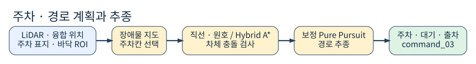

# parking_ws

## 설정별 상세 동작

아래는 선택 가능한 설정별 설명입니다. 현재 실차 기본값은 위 알고리즘 절과 `parking_real.yaml`을 기준으로 합니다.

출차는 곡선 후진이 남아 있으면 parking 제어를 유지합니다. `exit_curve_handoff: true`를 선택하면
마지막 곡선 후진을 마치고 실제 방향이 진입 차선 방향의 0.05rad 이내로 정렬되면,
남은 직선 후진과 전진 꼬리 경로를 생략하고 lane으로 제어권을 넘길 수 있습니다.
차체 전체가 주차 격자 밖이어야 하고 원래 차선 중심에서 가로 오차 20cm 이내여야 합니다.
출차 시작 뒤 새로 인식한 차선 및 최신 lane 전진 명령, 정상 위치·스캔도 필요합니다.

이양 전에는 parking의 0속도 명령을 유지하며 최신 위치 관측에서 속도 0.03m/s 이하를 확인합니다.
차선 정보가 사라지면 한 번에 최대 0.8초만 정지를 시도하고, 기존 충돌 검사된 출차 경로를 계속 따릅니다.
같은 출차 중 정지 시도를 반복하지 않습니다. 차선이 처음부터 준비되지 않으면 정지 시도를 하지 않고
기존 출차를 진행합니다. 끝점 도착 판정은 기존 7cm·정렬·안전 조건을 유지합니다.
`exit_curve_handoff: false`는 남은 직선 후진도 끝점까지 수행하는 기존 동작입니다.

주차 완료 전 융합 위치 또는 `/localization/health`의 시각·좌표계·자세·속도·공분산 오류나 융합 준비 실패가 나면,
주차 미션을 유지한 채 이전 위치 이력·대기 스캔·라이다 매칭 기준·장애물 지도·경로·비동기 계획·접근 기준점을 모두 폐기합니다.
복구 도중 다시 오류가 나도 그 사이 받아 둔 위치와 경로를 다시 비웁니다.
폐기 시각 이후의 정상 EKF·health·라이다로 재매칭하며, 완료 전에는 parking의 정지 명령을 유지합니다.
복구 도중 추가 지연 데이터가 와도 기준 시각을 반복해서 옮기지 않습니다. 입력이 계속 잘못되면 정지 대기합니다.
주차 시도 번호·활성 상태와 후진 복구 횟수/거리 제한은 유지합니다. 별도 접근 기준점도 폐기하며 새 시작 신호가 필요합니다.
실차는 `localization_max_stddev: 0.0`, `localization_max_yaw_stddev: 0.0`으로 위치·방향 공분산의 크기 상한을 모두 해제합니다.
0은 상한 해제이고, 양수는 해당 표준편차 한계를 다시 적용합니다. 두 값은 실행 중 ROS 파라미터로 조정할 수 있습니다.
NaN·무한대·0 이하 공분산, 잘못된 시각·좌표계·자세·속도는 계속 거부합니다. 주차 완료 전에는 최신성 한계 0.3초와 오류 시 전체 폐기를 유지합니다.

주차 완료 후 대기·후진 출차 중에는 완료 시각·목표·진입 기록·출차 경로·지도와 기준 좌표계를 보존합니다.
fused 모드는 완료 시점의 EKF 보정 변환을 고정하고 이후 odom의 이동·회전으로 경로를 추종합니다.
라이다는 최신 장애물 관측과 충돌 검사에 계속 사용하며 위치 재매칭과 지도 재정렬은 하지 않습니다.
이 구간의 `/localization/health` 미수신·지연·ready=false는 진단 정보로만 처리하고,
제어와 mux 준비 상태는 유효한 odom·라이다를 기준으로 판정합니다.
odom 또는 라이다가 끊기면 경로를 버리지 않고 정지하며, 같은 좌표계의 정상 입력이 복구되면 이어갑니다.
위치 도약은 잘못된 좌표계에서 후진하지 않도록 정지 상태를 유지하며 `/parking/reset`이 필요합니다.
`manual_mode_guard: false`를 선택하면 차량의 수동/오토 모드를 감시하지 않습니다(현재 실차 설정은 true).
수동 전환을 이유로 경로를 지우거나 미션을 초기화하지 않으며, 별도의 복귀 로직은 없습니다.
차체가 주행 모드를 처리하고 parking은 기존 경로와 상태를 계속 유지합니다.
20초 무진행 실패 처리와 센서·장애물 검사, 명시적 초기화, 출차 완료와 lane 이양 조건은 그대로 적용합니다.

이미 출차 완료한 미션은 자동으로 다시 시작하지 않습니다. 정합 프레임이 바뀌므로 과거 지도나 출차 경로를 재사용하지 않습니다.

차량 오른쪽의 장애물과 빈 주차칸을 찾고, 경로 생성·추종·주차·출차를 수행합니다.
위치는 sensor_ws의 휠·IMU 융합 결과를 사용하고, 라이다 관측을 기억 지도에 누적합니다.

## 알고리즘

라이다 관측과 융합 위치로 빈 주차칸을 고릅니다. 직선·원호 후보와 Hybrid A*로 경로를 찾고 차체 충돌을 검사한 뒤, 보정 Pure Pursuit로 주차·출차 경로를 추종합니다. [1][2][3]



## References

- [1] Y. Chen, G. Medioni, **Object Modeling by Registration of Multiple Range Images**, ICRA, 1991. [논문](https://graphics.stanford.edu/courses/cs164-09-spring/Handouts/paper_chenmedioni.pdf). 법선 방향 거리 최소화에 기반한 정합의 관련 연구입니다. 본 코드는 2D 점-직선 정합과 EKF/이동량 제약을 사용합니다.
- [2] D. Dolgov, S. Thrun, M. Montemerlo, J. Diebel, **Practical Search Techniques in Path Planning for Autonomous Driving**, AAAI Workshop, 2008. [논문](https://ai.stanford.edu/~ddolgov/papers/dolgov_gpp_stair08.pdf). 연속 차량 자세를 유지하는 Hybrid A* 탐색의 관련 연구입니다.
- [3] R. C. Coulter, **Implementation of the Pure Pursuit Path Tracking Algorithm**, CMU-RI-TR-92-01, 1992. [CMU 원문](https://www.ri.cmu.edu/publication_view.html?pub_id=278). 전방 목표점 기반 추종의 배경입니다.

## 감속 시작 기준 상대 위치

lane이 주차 표지를 연속 2회 확인해 감속을 시작하면 `/parking/approach_start`
(`std_msgs/Header`, 시작 시각)를 발행합니다. fused 모드의 parking 노드는 그 시각에 맞춘
EKF 위치·방향을 기준점으로 저장합니다. EKF는 계속 실행하며 기존 주차 지도·경로·TF는 유지합니다.

`/parking/approach_odometry` (`nav_msgs/Odometry`)는 기준점에 대한 상대 x/y/yaw를
`parking_approach` 좌표계로 출력합니다. 기준점의 위치·방향은 0이며 twist는 기존
base_link 기준을 유지합니다. pose covariance는 고정 기준점 좌표계로 회전합니다.
이 토픽은 별도 관측 출력으로, 기존 경로 제어의 입력 토픽을 대체하지 않습니다. TF는 추가하지 않습니다.

시작 시각을 사이에 둔 EKF 샘플로 위치를 보간하고, 최대 `localization_timeout`(기본 0.3초)까지만 기다립니다.
오래된·미래·초기화 이전 신호는 거부하며, 데이터 누락 시 기준점을 만들지 않고 로그를 남깁니다.
중복 시작 신호는 현재 기준점을 바꾸지 않습니다. `/parking/reset` 또는 기존 시계 역행 초기화 때
기준점을 해제합니다. 신호는 volatile QoS로 발행되므로 수신 노드는 감속 시작 전에 실행해야 합니다.

```bash
ros2 topic echo /parking/approach_odometry
```

## 빌드와 실차 실행

센서와 mux를 먼저 실행합니다. ROS 2 Humble 시스템 환경에서 빌드하세요.

```bash
cd ~/2026-AutoRace/parking_ws
source /opt/ros/humble/setup.bash
source ../sensor_ws/install/setup.bash
/usr/bin/python3 -m colcon build --symlink-install
export ROS_DOMAIN_ID=94 ROS_LOCALHOST_ONLY=0
source real_env.sh
ros2 run autorace_parking parking_node --ros-args \
  --params-file ~/2026-AutoRace/parking_ws/src/autorace_parking/config/parking_real.yaml
```

실차는 `parking_real.yaml`을 사용합니다. bare run과 기본 launch의 설정은 실차 프로필과 다르며, 기본 launch는 시뮬레이션 시간을 사용합니다.
실차 launch를 쓰려면 명시적으로 설정합니다.

```bash
ros2 launch autorace_parking parking.launch.py use_sim_time:=false \
  params_file:=$HOME/2026-AutoRace/parking_ws/src/autorace_parking/config/parking_real.yaml
```

RViz는 같은 ROS 도메인과 환경에서 실행합니다.

```bash
rviz2 -d ~/2026-AutoRace/parking_ws/parking_real.rviz
```

## 동작 흐름

1. `/yolo/parking_sign`의 true를 연속 3회 받으면 시작합니다. 이후 5초의 무시 구간이 지난 뒤 true를 다시 받으면 위치 추정의 미션 기준·기억 지도·목표·경로를 초기화해 새로 시작합니다. 공용 EKF 자체를 초기화하는 것은 아닙니다.
2. 미션 시작 위치에 고정한 ROI에서 후보를 찾습니다. 전방 x는 **0~3m**, 오른쪽 거리는 **0~2m**이며 ROS 좌표 y로는 **-2~0m**입니다.
3. 장애물 배치를 두 객체 사이 또는 6칸 지도와 정합해 빈 공간의 목표를 선택합니다. 칸 영역 전체가 아닌 실제 관측·기억 장애물 점과 차체·여유 공간으로 충돌을 검사합니다.
4. 연결 가능한 경로를 추종해 주차합니다. 차량 중앙을 목표에 맞추고 도착 오차는 뒤축 기준으로 계산합니다.
5. 도착 후 3초 정지하고 기록한 진입 경로를 이용해 후진 출차합니다.

## 후진과 제어권

- 복구 후진은 필요한 조건에서 정지 확인 후 수행합니다. 한 번에 실제 **최소 20cm**, 최대 **30cm**, 속도 **0.2m/s**, 최대 **5회**이며 누적 한도도 검사합니다.
- 후진 충돌 여부는 기억 지도로 판단합니다. 지도에 점이 없는 후방은 빈 공간으로 취급하므로 지도에 없는 실제 장애물은 검출하지 못할 수 있습니다.
- 경로가 없을 때는 주행 명령을 계속 발행하지 않습니다. 복구 후 새 진입 경로가 없으면 정지를 확인하고 제어를 해제하며, mux의 입력 만료 후 다른 유효 미션 또는 lane이 선택됩니다.
- 관측과 재계획은 계속합니다. 연결 가능한 새 진입 경로를 확보하면 parking 제어를 다시 시작합니다.

## 주요 토픽

| 방향 | 토픽 | 내용 |
| --- | --- | --- |
| 입력 | `/yolo/parking_sign` | 주차 시작 신호 |
| 입력 | `/scan` | 라이다 |
| 입력 | `/odometry/filtered`, `/localization/health` | 융합 위치와 준비 상태 |
| 출력 | `/mission/parking/command_03` | mux에 전달하는 주차 명령 |
| 출력 | `/parking/path` | 주차 경로 |
| 출력 | `/parking/lookahead` | 추종 목표점·lookahead 표시 |
| 서비스 | `/parking/reset` | 미션 초기화 |

지도·장애물·목표·ROI 표시는 포함된 RViz 설정에서 함께 확인할 수 있습니다.

## 조향과 설정

경로와 추종기는 실제 중앙 조향각을 기준으로 계산합니다. 발행 직전에만 gain **1.92**, deadband **0.23**, 전송값 상한 **0.35**의 보정을 기존 드라이버 변환에 맞춰 적용합니다.
따라서 명령 토픽의 조향각 숫자는 추종기가 계산한 실제 목표각과 다를 수 있습니다. 드라이버 보정은 OFF여야 하며, 중복 보정이 확인되면 주행을 대기합니다.
조향 변화율 제한은 기본 0으로 즉시 출력합니다.

실차 파라미터는 `src/autorace_parking/config/parking_real.yaml`에서 확인하세요.
분석·검증 도구는 `tools/`, 회귀 테스트는 `src/autorace_parking/test/`에 있습니다.
시뮬레이터 사용법은 [simul 문서](../simul/README.md)를 참고하세요.


## 2026-11-10 진입 경로와 종단 복구 보정

실차 프로파일은 기존 차체 충돌 여유 10cm와 계획 추종 여유 2cm를 유지합니다.
먼저 기존 방식으로 안전한 전진 경로를 구하고, 여유가 부족할 때만 인접 후보 최대 8개에
차체–장애물 거리 비용을 적용합니다. 이미 넉넉한 경로나 전진 불가능한 장면에는 후보 탐색을 추가하지 않습니다.
거리 비용은 최대 48개 자세/최근접 16개 점으로 제한하고 KDTree 질의를 묶습니다.
최종 채택 경로는 기존 촘촘한 차체 충돌 검사를 모두 통과해야 합니다. 목표 마지막 25cm에서는
선호 여유를 서서히 해제해 좁은 칸의 도달 가능성을 유지합니다.

실차 속도는 진입 최대 0.20m/s, 복구 후진 최대 0.12m/s, 목표 15cm 안에서는 최대 0.06m/s입니다.
조향 추종 이득 1.2와 변화율 1.2rad/s를 사용하며, 최소 회전 속도가 조향 정착 감속을 덮어쓰지 않습니다.
진입 명령의 정지 거리 예측에 장애물이 있으면 낮은 속도를 재검사합니다. 실측 속도와 기존 차체 여유를
계속 반영하므로 실제 속도가 높거나 낮춘 속도에서도 막히면 정지합니다.

실차는 `replan_while_following: false`로 확정 경로를 정상 추종 중이면 반복 계획을 생략하고,
경로 차단·정면 근접·재관측 상태에서는 즉시 다시 계획합니다. 일반 설정에서도 목표 12cm 안에서는 새 계획을 반복하지 않습니다. 뒤늦게 도착한 계획 실패
복구도 `PARKING`/`CONFIRMING` 중이고 정면 장애물이 없을 때만 보류합니다. 실제 경로 차단,
정면 근접, 출차, 복구에는 이 억제를 적용하지 않습니다. 중앙 목표의 정지 오차 3cm는 유지합니다.
상태의 `effective_stop_tolerance_m`은 일반 도착 허용값과 구별해 현재 적용 중인 값을 표시합니다.

`tools/check_parking_bag_model.py`의 `--scene-start`, `--start-pose X Y YAW`, `--locked-goal`로
동일 지도/목표/시작 자세에서 이전·수정 설정의 주차와 출차를 재현할 수 있습니다.
`accepted_paths`에는 진입·복구·출차 계획을 구분해 저장합니다. 이것은 정적/기록 지도 기반
폐루프 차량 모델이며 새 실차 주행 결과를 의미하지 않습니다. 격리된 ROS 도메인 160~199 및
`ROS_LOCALHOST_ONLY=1`에서만 실행할 수 있습니다.

출차 계획도 `exit_path_tracking_margin: 0.04`로 차체 기본 10cm에 추가 4cm의 여유를 확보하고,
진입과 동일한 거리 선호를 적용합니다. 출차는 역방향 좌표계에서 계산하므로 결과 자세를 실제 차체
방향으로 복원해 충돌을 검사합니다. 비동기 계획이 완료된 시점에도 최신 지도와 현재 위치에서
접속 구간 및 전체 경로를 같은 14cm 기준으로 재검사합니다. 이 여유가 확보되지 않으면 해당
계획을 거부하고 정지 상태에서 다시 계산합니다. 실제 제어의 충돌·제동 검사 10cm 기준은 유지합니다.

## 직선 뒤 단일 곡선에서 끝나는 진입

실차는 `prefer_arc_finish_entry: true`, `preferred_turn_radius: 0.67`로 직선 접근 뒤
주차 중심에서 끝나는 한 방향 원호를 먼저 검사합니다. 곡선 뒤에 긴 직선 진입을 붙이지 않습니다.
반경 67cm는 물리 최소 반경 53cm보다 넉넉하며, 계획 최대 반경은 70cm입니다.
조향 변화율 제한·정착 감속은 기존 설정을 적용합니다.

선호 원호도 기존 촘촘한 차체 검사, 기본 10cm+진입 추종 2cm 여유, 경로 길이 제한을
모두 통과해야 합니다. 원호가 불가능하면 기존 후보·탐색 방식으로 계획합니다. 요구된 종단 방향을
무시하지 않으며, 출차 계획에는 이 진입 선호를 적용하지 않습니다. 이 원호가 가능하면 많은
후보를 만들기 전에 반환하므로 계산량도 줄어듭니다.


### 융합 상태 지연 시 기존 경로 추종과 재수신 복구
실차 설정 `health_path_hold_timeout: 2.0`은 `/localization/health`만 늦을 때
이미 승인된 경로를 EKF 위치로 최대 2초 동안 추종한다. 마지막 health가 정상이어야 하며,
새 EKF는 기존 0.3초, 처리된 라이다는 0.5초, 최근 수신 스캔은 0.3초 제한을
계속 만족해야 한다. 새 장애물·차선 충돌 검사도 그대로 수행한다.
이 기간에는 경로를 새 계획 결과로 바꾸지 않고 MUX ready도 같은 조건으로 유지한다.
새 health가 도착하면 같은 경로·좌표계에서 정상 갱신을 재개한다.

2초 초과 또는 기존 경로가 없으면 정지 대기한다. health 지연만으로 정상인
EKF·스캔·지도·경로와 부분 복구 버퍼를 반복 폐기하지 않는다. EKF 불연속·잘못된
위치 입력과 실제 센서 불량(ready=false)은 기존 정지/초기화 검사를 유지한다.
위치 복구·스캔·초기화 대기는 20초 무이동 실패 시간에 포함하지 않는다.
상태의 `synchronization.health_path_tracking`, `health_path_hold_timeout_s`로
기존 경로 사용 여부를 확인할 수 있다. 값 0은 이 기능을 끈다(단독 노드 기본값).

health 구독은 깊이 1의 BEST_EFFORT로 최신 상태를 받으며, parking과 sensor_fusion은
고정된 단일 executor에서 실행해 매 콜백마다 노드를 등록·해제하지 않는다.
설정·코드 적용은 관련 노드를 다시 실행한 뒤 이루어진다.

주차 종료 후 lane 우선권을 단조 시계로 10초 유지한다. 이 시간에는 parking 시작/상태/명령 재수신도 무시하며 재시작 요청을 예약하지 않는다. 10초 후 새 parking 표지를 받고 흰 바닥선 조건을 만족하면 다시 parking으로 전환한다. lane 명령이 끊기면 정지한다. 다른 미션은 주차 이후 lane/parking 반복에서 선택하지 않는다.
