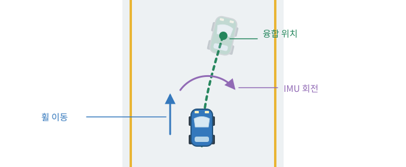

# sensor_ws

카메라·LiDAR·차체 데이터를 받고, 휠·IMU를 융합해 위치를 추정합니다.

## 입력·출력 토픽

토픽 이름·메시지 타입 펼쳐보기

| 방향 / 담당 | 토픽 | 타입 | 내용 / 연결 |
| --- | --- | --- | --- |
| 입력 · 차체 | `/cmd_vel` | `geometry_msgs/msg/Twist` | mux가 선택한 차량 속도·각속도 |
| 출력 · 카메라 | `/camera/color/image_raw` | `sensor_msgs/msg/Image` | 원본 컬러 영상 |
| 출력 · 카메라 | `/camera/color/image_raw/compressed` | `sensor_msgs/msg/CompressedImage` | YOLO·차선·바닥 ROI 입력 |
| 출력 · LiDAR | `/scan` | `sensor_msgs/msg/LaserScan` | 주차·콘·장애물 회피 입력 |
| 출력 · 차체 → 전처리 | `/odom` | `nav_msgs/msg/Odometry` | 원본 휠 위치·속도 |
| 출력 · 차체 → 전처리 | `/imu` | `sensor_msgs/msg/Imu` | 원본 IMU |
| 출력 · 차체 | `/limo_status` | `limo_msgs/msg/LimoStatus` | 차량 제어 모드 등 |
| 출력 · 전처리 → EKF | `/localization/wheel` | `nav_msgs/msg/Odometry` | 검증한 휠 속도 |
| 출력 · 전처리 → EKF | `/localization/imu` | `sensor_msgs/msg/Imu` | 장착 방향·바이어스 보정 IMU |
| 출력 · 전처리 | `/localization/health` | `std_msgs/msg/String` | 최신성·보정 준비 상태 |
| 출력 · EKF | `/odometry/filtered` | `nav_msgs/msg/Odometry` | 융합 위치·방향 |
| 출력 · TF 발행 노드 | `/tf`, `/tf_static` | `tf2_msgs/msg/TFMessage` | 차체·센서 좌표 변환 |
| 출력 · 모델 노드 | `/robot_description` | `std_msgs/msg/String` | 차량 모델, description 활성화 시 |

| 서비스 | 타입 | 역할 |
| --- | --- | --- |
| `/localization/calibrate_gyro` | `std_srvs/srv/Trigger` | 정지 자이로 보정 재시작 |
| `/set_pose` | `robot_localization/srv/SetPose` | EKF 기준 자세 설정 |

## References

- [1] T. Moore, D. Stouch, **A Generalized Extended Kalman Filter Implementation for the Robot Operating System**, IAS-13, 2014. [논문](https://docs.ros.org/kinetic/api/robot_localization/html/_downloads/robot_localization_ias13_revised.pdf)

[통합 실행](../tensor_bringup/README.md) · [전체 토픽](../docs/architecture.md)
