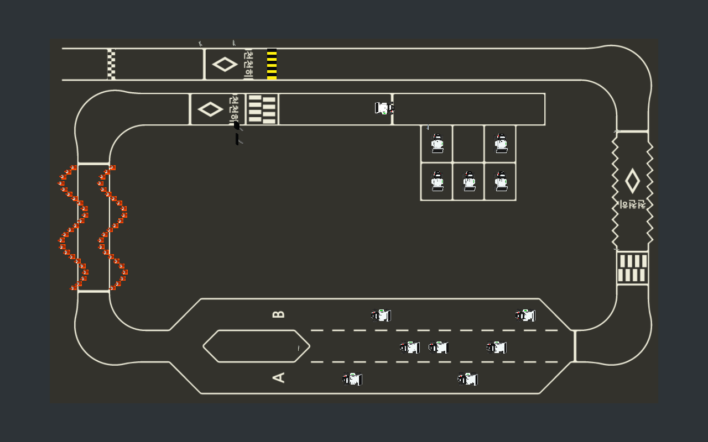
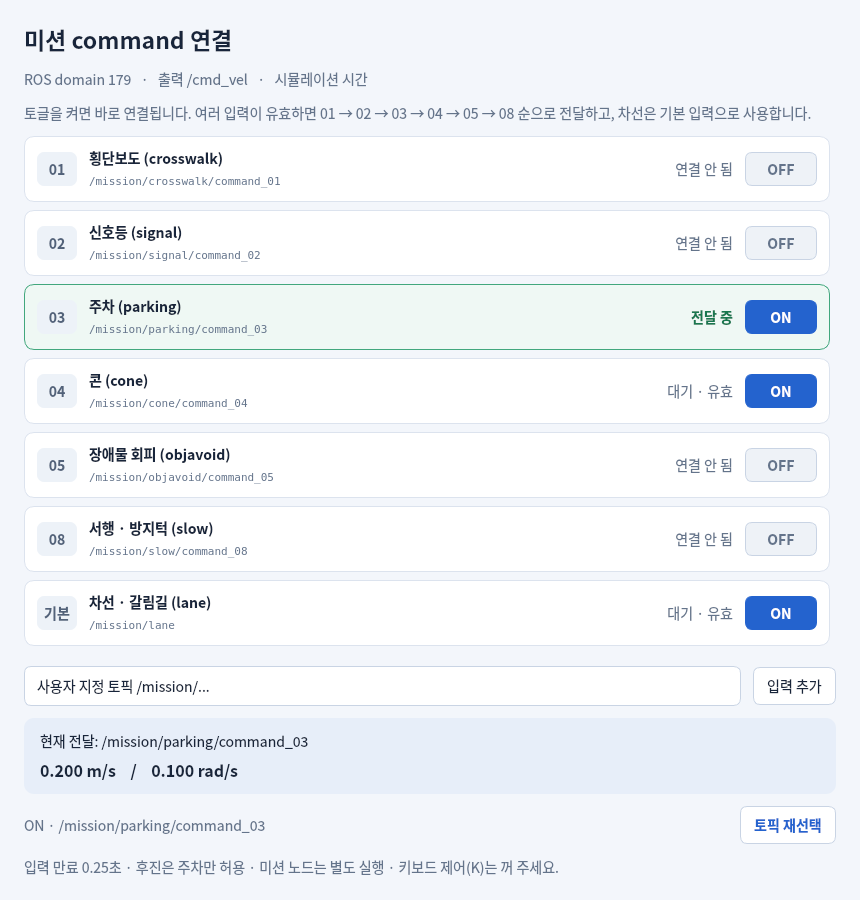

# LIMO Pro AutoRace 미션 시뮬레이터

Panda3D와 ROS 2로 만든 **10 × 6 m 트랙의 LIMO Pro 주행 시뮬레이터**입니다. 차량 운동과 충돌, 카메라 RGB·깊이 영상, 라이다를 제공하며 차선 주행·서행·횡단보도·장애물 회피·갈림길·콘·신호등·주차 미션을 시험할 수 있습니다.

시뮬레이터는 트랙과 센서·차량을 제공하고, 인지·주행 알고리즘은 별도 노드에서 실행합니다. 미션 명령은 어댑터를 통해 차량에 전달하며, 자동 주행 알고리즘이나 점수·성공 판정은 포함하지 않습니다.



## 1. 환경 설정

Ubuntu 22.04, ROS 2 Humble, Conda가 설치된 환경을 기준으로 합니다. **아래 명령어는 `simul` 폴더에서 실행합니다. 새 터미널을 열 때마다 같은 환경을 적용하세요.** 저장소가 다른 위치에 있으면 `cd` 경로를 바꿉니다.

```bash
cd /home/a/2026-AutoRace/simul
source env.sh
```

`source env.sh`는 다음을 준비합니다.

- `autorace-simul` Conda 환경을 생성하거나 기존 환경을 활성화합니다. Python 3.10, Panda3D, NumPy, Pillow, Tk, PyQt 등 필수 패키지를 확인하고 필요하면 보완합니다.
- 시스템 ROS 2와 시뮬레이터 Python 소스 경로를 연결합니다. 시뮬레이터는 별도 colcon 빌드 없이 실행할 수 있습니다.
- 기본 `ROS_DOMAIN_ID`를 **42**, `ROS_LOCALHOST_ONLY`를 **1**로 설정합니다. 이미 지정한 0 이외의 도메인은 유지하므로 시뮬레이터·어댑터·미션 노드가 같은 도메인을 쓰도록 맞춥니다.

최초 환경 생성·패키지 보완에는 인터넷이 필요합니다. `./env.sh`가 아닌 **`source env.sh`**로 실행해야 현재 터미널에 환경이 적용됩니다. 최초 설치나 수동 설정은 [설치 가이드](docs/SETUP.md)를 참고하세요.

## 2. 시뮬레이터 실행

환경 설정 후 전체 트랙과 콘·주차·장애물 배치 편집 창을 함께 엽니다.

```bash
./run.sh --mission track --view overview --editor
```

저장소 루트에서 실행하는 `./simul.sh`도 같은 기본 옵션을 사용합니다. 아래 명령은 `simul` 폴더 기준입니다.

```bash
# 전체 트랙만 열기
./run.sh --mission track --view overview

# 창 없이 센서 렌더링과 ROS 토픽 발행
./run.sh --mission track --headless

# ROS 없이 수동 조작으로 장면 확인
./run.sh --mission track --view overview --no-ros
```

`--mission`은 차량의 시작 위치를, `--view`는 관찰 화면을 선택합니다. 사용할 미션을 명시하면 원하는 구간에서 바로 시작할 수 있습니다. `./run.sh`만 실행하면 기존 기본 위치인 주차 접근 지점에서 시작합니다.

| 옵션 | 의미 |
| --- | --- |
| `--view overview` | 전체 트랙 보기 |
| `--view follow` | 주행 차량을 따라가는 화면 |
| `--view camera` | 차량의 전방 카메라 시점 |
| `--view parking` | 주차 구역을 보는 화면 |
| `--editor` | 콘·주차·장애물 배치 편집 창도 열기 |
| `--headless` | 화면 창 없이 렌더링. ROS 센서는 계속 발행 |
| `--no-ros` | ROS 연결 없이 실행 |
| `--spawn X Y YAW` | 시작 좌표를 직접 지정. 단위는 m, m, rad이며 `--mission`의 위치보다 우선 |

## 3. 미션별 시작 명령

아래에서 **시험할 미션의 명령 하나를 선택**합니다. 각 명령은 해당 구간에서 시뮬레이터를 시작하며, 미션 알고리즘 노드는 별도로 실행해야 합니다.

| 미션 | 시험할 장면 | 시뮬레이터 실행 명령 |
| --- | --- | --- |
| 전체 트랙·기본 차선 주행 | 출발선에서 전체 코스 주행 | `./run.sh --mission track --view overview` |
| 방지턱·서행 (`slow`) | 상단 직선의 방지턱과 방지턱 표지판 | `./run.sh --mission slow --view follow` |
| 횡단보도 (`crosswalk`) | 오른쪽 횡단보도와 보행자 표지판 | `./run.sh --mission crosswalk --view follow` |
| 장애물 회피 (`objavoid`) | 3개 차로에 배치한 정차 차량 7대 | `./run.sh --mission obstacle --view follow` |
| 갈림길 (`fork`) | A/B 표지판에 따른 좌·우 분기 | `./run.sh --mission fork --view follow` |
| 콘 (`cone`) | 콘 48개로 만든 연속 S자 통로 | `./run.sh --mission cone --view follow` |
| 신호등 (`signal`) | 3색 신호등과 방해 광고판 | `./run.sh --mission signal --view follow` |
| 주차 (`parking`) | 정차 차량 5대와 빈 주차 칸 | `./run.sh --mission parking --view parking` |

**장애물 미션의 실행 옵션은 `obstacle`, 어댑터 입력 이름은 `objavoid`입니다.** 갈림길은 별도 command 없이 `lane` 입력으로 주행합니다. 지그재그 서행도 `slow` 입력을 사용하며, 별도의 `--mission zigzag` 옵션은 없습니다.

배치를 바꾸려면 선택한 명령 끝에 `--editor`를 추가합니다. 예를 들어 콘 구간은 다음과 같이 실행합니다.

```bash
./run.sh --mission cone --view follow --editor
```

## 4. 어댑터로 미션 명령 연결

미션 노드가 보내는 `AckermannDriveStamped`의 속도·조향각을 시뮬레이터의 `/cmd_vel` (`Twist`)로 변환하는 프로그램입니다. 시뮬레이터와 미션 노드를 실행한 뒤 **별도 터미널**에서 실행합니다.

```bash
cd /home/a/2026-AutoRace/simul
source env.sh
./adapter.sh
```

어댑터 창에서 시험할 미션의 토글을 **ON**으로 바꿉니다. 처음에는 모두 OFF이며, 미션 종료 후 기본 주행으로 돌아가려면 **차선·갈림길 (`lane`)도 함께 ON**으로 켭니다.

| 시험할 미션 | 어댑터에서 켤 입력 | 미션 입력 토픽 |
| --- | --- | --- |
| 기본 차선 주행·갈림길 | 차선·갈림길 (`lane`) | `/mission/lane` |
| 방지턱·지그재그 서행 | 서행·방지턱 (`slow`) + `lane` | `/mission/slow/command_08` |
| 횡단보도 | 횡단보도 (`crosswalk`) + `lane` | `/mission/crosswalk/command_01` |
| 장애물 회피 | 장애물 회피 (`objavoid`) + `lane` | `/mission/objavoid/command_05` |
| 콘 | 콘 (`cone`) + `lane` | `/mission/cone/command_04` |
| 신호등 | 신호등 (`signal`) + `lane` | `/mission/signal/command_02` |
| 주차 | 주차 (`parking`) + `lane` | `/mission/parking/command_03` |

여러 미션을 켜면 **01 → 02 → 03 → 04 → 05 → 08** 순서로 최신 유효 입력을 선택합니다. 미션 입력이 만료되면 ON 상태인 `lane`으로 복귀하고, 유효한 입력이 없으면 정지합니다. 입력 유효 시간은 0.25초이며, 후진은 주차 입력만 허용합니다. 선택된 입력은 창에서 초록색으로 표시합니다. **토픽 재선택**은 모든 입력을 OFF로 되돌립니다.



### 창 없이 미션별로 연결하기

위의 GUI 실행 대신 아래에서 **명령 하나를 선택**합니다. 각 명령은 해당 미션과 기본 차선 입력을 함께 연결합니다.

```bash
# 기본 차선 주행·갈림길
./adapter.sh --no-gui --topic /mission/lane

# 방지턱·지그재그 서행
./adapter.sh --no-gui --topic /mission/slow/command_08 --topic /mission/lane

# 횡단보도
./adapter.sh --no-gui --topic /mission/crosswalk/command_01 --topic /mission/lane

# 장애물 회피: 시뮬레이터의 --mission obstacle에 대응
./adapter.sh --no-gui --topic /mission/objavoid/command_05 --topic /mission/lane

# 콘
./adapter.sh --no-gui --topic /mission/cone/command_04 --topic /mission/lane

# 신호등
./adapter.sh --no-gui --topic /mission/signal/command_02 --topic /mission/lane

# 주차
./adapter.sh --no-gui --topic /mission/parking/command_03 --topic /mission/lane
```

미션·인지·차선 노드는 각 워크스페이스의 방법으로 별도 실행하고, **`use_sim_time:=true`**를 적용합니다. 이 노드들도 시뮬레이터와 같은 ROS 도메인을 사용해야 합니다. 어댑터를 켜는 것만으로 미션 명령이나 `/mission/lane`이 만들어지지는 않습니다. 입력 메시지의 헤더에는 현재 ROS 시각을 넣고, 속도는 m/s, 조향각은 rad로 발행합니다.

어댑터를 사용할 때는 `/cmd_vel`을 발행하는 기존 mux나 다른 어댑터를 종료합니다. mux로 차량 명령을 전달하는 구성이라면 이 어댑터는 실행하지 않습니다. `ackermann_msgs`가 없다는 오류가 나오면 `sudo apt install ros-humble-ackermann-msgs`로 설치합니다.

## 5. 토픽 확인

시뮬레이터를 ROS 모드로 실행한 상태에서 **새 터미널**을 열어 확인합니다.

```bash
cd /home/a/2026-AutoRace/simul
source env.sh
ros2 topic list
```

| 방향 | 주요 토픽 | 타입·내용 |
| --- | --- | --- |
| 발행 | `/camera/color/image_raw/compressed` | `CompressedImage`, 640×480 JPEG, 30 Hz |
| 발행 | `/camera/color/image_raw` | `Image`, RGB 640×480, 30 Hz |
| 발행 | `/camera/depth/image_raw` | `Image`, 깊이 640×400, mm 단위, 30 Hz |
| 발행 | `/camera/color/camera_info`, `/camera/depth/camera_info` | `CameraInfo`, 각 카메라의 투영 정보 |
| 발행 | `/scan` | `LaserScan`, 10 Hz |
| 발행 | `/imu`, `/odom` | `Imu` / `Odometry`, 50 Hz |
| 발행 | `/tf`, `/tf_static` | `TFMessage`, 차량·센서 좌표계 |
| 발행 | `/clock` | `Clock`, 시뮬레이션 시각 |
| 발행 | `/sim/ground_truth`, `/sim/parking_status` | 실제 시뮬레이션 위치와 차량 상태 |
| 구독 | `/cmd_vel` | `Twist`, 차량 선속도·각속도 |

주기는 시뮬레이션 시간 기준입니다. `/mission/*`와 `/yolo/*`의 명령·인지 결과를 받으려면 해당 미션·인지 노드를 별도로 실행해야 합니다. 시뮬레이터는 인지 Bool을 대신 발행하지 않습니다. `--no-ros`로 실행하면 센서 토픽도 발행하지 않습니다. 토픽이 보이지 않으면 모든 터미널에서 환경을 다시 적용하고 ROS 도메인이 같은지 확인합니다.

## 6. 콘·주차·장애물 배치 편집 창

`--editor`로 시뮬레이터와 함께 열거나 실행 중 **E**로 열고 닫습니다. 위쪽의 **콘 / 주차 / 장애물** 버튼으로 편집할 구역을 선택하고, **설치 대상 콘 / 차량**으로 배치할 물체를 고릅니다.

| 구역 | 배치 방식 |
| --- | --- |
| 콘 (`cone`) | 클릭한 위치에 콘을 자유롭게 배치 |
| 주차 (`parking`) | 차량을 3열 × 2행 주차 칸 중앙에 세로로 배치 |
| 장애물 (`objavoid`, 화면 이름: 장애물) | 차량을 3개 차로 × 8칸의 중앙에 배치 |

- **왼쪽 클릭:** 새 물체 설치. 기존 물체를 선택한 뒤 빈 곳을 클릭하면 이동합니다.
- **오른쪽 클릭:** 현재 설치 대상과 같은 종류의 물체를 삭제합니다.
- **새로 설치 / Esc:** 선택 해제. **되돌리기 / Ctrl+Z:** 직전 배치 변경 취소.

변경은 3D 장면·RGB·깊이·라이다·충돌에 즉시 반영되며, `src/limo_parking_sim/config/parking_map.obstacles.yaml`에 자동 저장되어 재실행 후에도 유지됩니다. `--map`으로 다른 맵을 쓰면 그 파일 옆의 `<맵 이름>.obstacles.yaml`에 저장합니다. 기본 배치로 돌아가려면 종료 후 해당 저장 파일의 이름을 바꾸세요.

## 7. 시뮬레이터 조작

| 키 | 동작 |
| --- | --- |
| K | 키보드 제어 켜기/끄기. 기본은 ROS 제어 |
| W 또는 ↑ | 전진, 1.0 m/s |
| S 또는 ↓ | 후진, 1.0 m/s |
| A / D 또는 ← / → | 좌 / 우 조향 |
| Space | 정지 |
| 마우스 왼쪽 드래그 | 관찰 화면 위치 이동 |
| 마우스 오른쪽 드래그 | 바라보는 지점을 중심으로 화면 회전 |
| 마우스 휠 | 확대 / 축소 |
| 1 / 2 / 3 / 4 | 주차장 / 전체 트랙 / 차량 추적 / 전방 시점 |
| L / R | 갈림길의 왼쪽 A / 오른쪽 B 표지판 표시. 차량 위치 유지 |
| I | 라이다 광선 표시 / 숨김. 기본 숨김 |
| V | 오른쪽 위 카메라 영상 표시 / 숨김. 기본 숨김 |
| E | 콘·주차·장애물 배치 편집 창 열기 / 닫기 |
| P | 일시정지 / 계속 |
| T / G / Y | 신호등 적색 / 녹색 / 황색 |
| F5 | 선택한 미션의 시작 위치로 차량 리셋 |
| Esc | 종료 |

## 8. 설정 파일과 상세 문서

| 항목 | 파일 |
| --- | --- |
| 차량 치수·운동·센서·토픽 설정 | [limo_pro.yaml](src/limo_parking_sim/config/limo_pro.yaml) |
| 트랙·미션 시설물·기본 장애물·시작 위치 | [parking_map.yaml](src/limo_parking_sim/config/parking_map.yaml) |
| 최초 설치·수동 환경 구성 | [SETUP.md](docs/SETUP.md) |
| 미션 시설물의 세부 배치 | [MISSIONS.md](docs/MISSIONS.md) |
| 센서 기본값·QoS | [SENSOR_DEFAULTS.md](docs/SENSOR_DEFAULTS.md) |
| 실차 카메라와의 차이·보정 | [CAMERA_MATCH.md](docs/CAMERA_MATCH.md) |
| 전체 워크스페이스·토픽 연결 | [architecture.md](../docs/architecture.md) |
