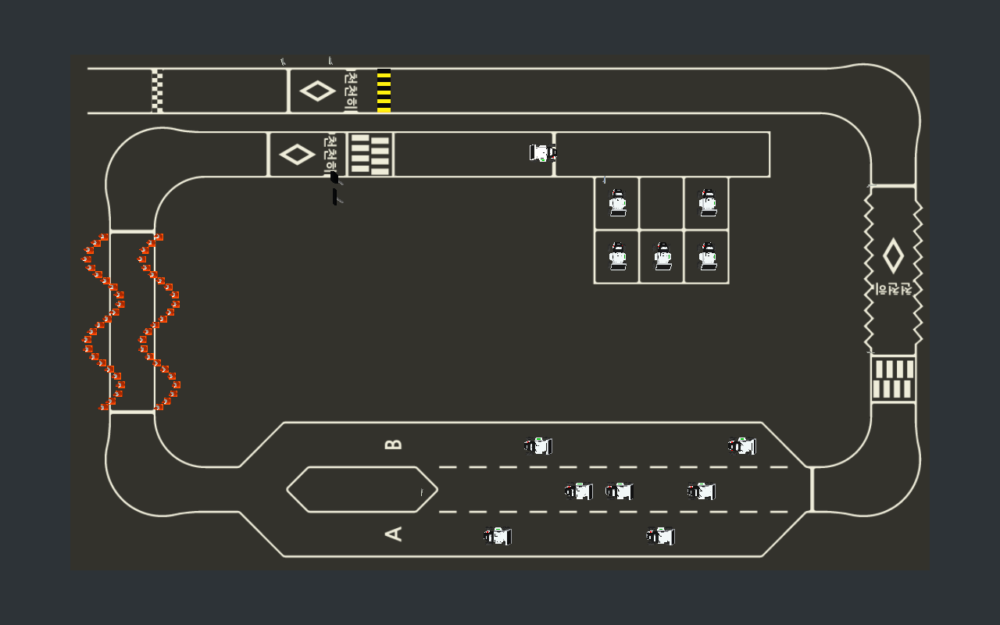

# 미션 시설물과 조작

미션 알고리즘은 사용자가 작성합니다. 이 시뮬레이터는 트랙, 시설물, 차량 운동과 센서 입력을 제공합니다. 점수·미션 판정은 없습니다.

## 전체 배치



| 미션 | 배치 |
| --- | --- |
| 방지턱·서행 | 상단 직선의 흰 기준선 옆 방지턱/서행 표지판, 높이 18 mm의 검정·노랑 방지턱 |
| 지그재그 서행 | 오른쪽 지그재그 진입선 옆 서행 표지판, `천천히` 노면 문구·속 빈 마름모 |
| 보행자 정지 | 오른쪽 횡단보도 기준선 옆 보행자 표지판 |
| 정적 장애물 회피 | 사용자 그림대로 위쪽 3·8번, 가운데 4·5·7번, 아래쪽 2·6번에 LIMO 7대. 격자·색상·번호는 표시하지 않음 |
| 갈림길 | 사용자가 지정한 섬의 오른쪽 끝에 왼쪽 A / 오른쪽 B 표지판. 접근하는 차량을 향함 |
| 콘 회피 | 두 흰 정지선 사이에 양쪽 24개씩 총 48개. 좌우 이동 폭 40 cm의 S자 두 개가 연속되며 오른쪽을 포함한 양쪽 흰 차선 밖까지 사용. 붉은 경로선 없음 |
| 신호등 | 안쪽 상단 횡단보도 옆 3색 신호등과 방해 광고판 |
| 주차 | 가운데 앞줄 빈 칸, 양옆 2대·안쪽 줄 3대의 정차 차량, 흰 선 옆 P 표지판 |

정차 차량은 총 12대입니다. 표지판·장애물의 세부 배치는 자료에 확정 좌표가 없어 사용자 요청에 맞춘 연습 배치이며 YAML에서 조정합니다. 원본 도면의 도로·차선·주차 칸 치수는 유지합니다.

원형 표지판은 **원판을 포함한 전체 높이 200 mm**, 원판 지름 90 mm, 인쇄부 지름 80 mm, 판 두께 10 mm입니다. 판 중심은 지면에서 155 mm, 판 아래 보이는 지주는 110 mm입니다. 지주만 200 mm로 만든 것이 아닙니다. 방지턱·보행자 삼각 표지판은 원래 삼각형 모양을 유지하며 전체 높이를 200 mm로 맞췄습니다.

[콘만 배치한 화면](missions-check/cone-layout.png) · [장애물 7대 배치](missions-check/obstacle-layout.png) · [표지판 근접 화면](missions-check/sign-size-closeup.png)

## 시작 위치 선택

```bash
conda activate autorace-simul
cd ~/2026-AutoRace

./simul/run.sh --mission track --view overview
./simul/run.sh --mission slow --view follow
./simul/run.sh --mission crosswalk --view follow
./simul/run.sh --mission obstacle --view follow
./simul/run.sh --mission fork --view follow
./simul/run.sh --mission cone --view follow
./simul/run.sh --mission signal --view follow
./simul/run.sh --mission parking --view parking
```

기존 기본 실행은 주차 접근 위치를 유지합니다. `--spawn x y yaw`를 함께 지정하면 미션 기본 위치 대신 해당 좌표를 사용합니다. ROS launch에서는 `mission:=cone`, `view:=follow`처럼 지정합니다. F5와 `/sim/reset`은 선택한 시작 위치로 돌아갑니다.

## 키

| 키 | 동작 |
| --- | --- |
| L | 갈림길 표지판을 왼쪽 A로 교체 |
| R | 갈림길 표지판을 오른쪽 B로 교체 |
| I | 라이다 광선 표시/숨김. 센서 발행은 계속 |
| V | 카메라 미리보기 표시/숨김. 센서 발행은 계속 |
| T / G / Y | 신호등 적색 / 녹색 / 황색 |
| K | 수동 운전 모드 켜기/끄기 |
| W / ↑ | 수동 전진, 1.0 m/s |
| S / ↓ | 수동 후진, 1.0 m/s |
| A / D, ← / → | 수동 조향 |
| Space | 수동 정지 |
| F5 | 차량 리셋 |
| 마우스 왼쪽 / 오른쪽 드래그 | 관찰 화면 이동 / 회전 |
| 휠 | 관찰 화면 확대·축소 |

L/R은 차량을 리셋하지 않습니다. F5는 차량을 초기화하고, 선택해 둔 표지판과 신호등 색은 유지합니다. 시뮬레이터는 `/yolo/LR_sign`이나 `/yolo/signal`을 대신 발행하지 않으므로, 자신의 YOLO 노드가 변경된 실제 카메라 영상을 인식하도록 연결합니다.

## 노면 표시 수정

원래 변환 과정의 빈 공간 채우기가 글자의 구멍과 횡단보도의 검정 간격까지 메웠습니다. 이를 수정해 횡단보도 두 곳의 줄 16개·경계선 4개를 CAD 좌표로 따로 복원하고, 속 빈 마름모·체커 출발선·A/B를 다시 그렸습니다. `천천히`는 한글 폰트로 별도 래스터화하여 8,000×4,800 텍스처에 저장합니다. 실행 시 한글 폰트를 추가 설치할 필요가 없습니다. 트랙에는 mipmap과 이방성 필터를 적용합니다.

표지판 이미지는 `assets/signs`의 원본을 사용합니다. 신호등은 실제로 켜지는 3D 원형 등이며, T/G/Y에 따라 카메라의 색도 달라집니다.

## 장애물·콘 검증

장애물의 8칸은 위치를 지정하는 설정 자료입니다. 차량 중심의 x좌표는 직선 구간 4.268~8.030 m를 8등분하여 정하고, 위/가운데/아래 차로 중심은 y=1.46/0.94/0.42 m입니다. 실제 화면에는 칸·번호·색상 영역을 만들지 않습니다. 7대 배치에서 차로 사이의 여유 공간으로 회피할 수 있는 경로를 검사합니다.

콘은 y=1.86~3.92 m 두 흰 정지선 사이에 배치합니다. 첫/마지막 받침의 끝을 정지선 안쪽 끝에 맞추며, 양쪽 줄은 각 줄의 길이를 따라 균일하게 이어집니다. 안쪽 굴곡에 콘이 겹치거나 바깥쪽 간격이 크게 벌어지지 않도록 배치합니다. `cone_course` 설정에서 수량·S자 진폭·통로 폭을 바꿀 수 있습니다. 경로 자체는 렌더링하지 않습니다. 두 구간 모두 차체 외곽 충돌, 실제 Ackermann 회전 한계와 조향 속도를 적용해 주행을 검사합니다.

최신 콘 코스는 진폭 20 cm, 좌우 이동 폭 40 cm의 **S자 두 개가 연속**됩니다. `half_waves: 4`, `phase_deg: -90`으로 정지선 사이에 오른쪽·왼쪽·오른쪽·왼쪽 굴곡이 모두 들어갑니다. 차량·콘 모두 양쪽 흰 차선을 넘어가도록 허용합니다. 콘 줄의 가로 간격을 64 cm로 넓히고, 전체 개수를 48개로 늘려 촘촘함을 유지했습니다. `--mission cone` 시작 위치도 새 통로 입구에 맞췄습니다.

콘 줄의 가운데를 그대로 따라가는 곡률과 차량이 실제로 주행할 수 있는 경로는 다릅니다. 두 정지선 사이에서 큰 S자 두 개의 가운데만 따라가면 LIMO Pro의 조향 한계를 넘습니다. 따라서 차량이 콘 사이 공간을 활용해 완만하게 통과할 수 있도록 통로를 확보했습니다. 독립된 검증용 경로의 최소 회전반경은 약 51.7 cm로 차량 한계 약 46.2 cm보다 큽니다. 차체 외곽이 콘 받침과 부딪히지 않는지와 실제 조향 속도로 통과하는지도 확인합니다. 이 검증용 경로는 화면에 표시하거나 기본 제어에 연결하지 않습니다.

콘은 높이 180 mm, 받침 폭 80 mm이며 원뿔 옆면의 실제 스캔 높이 반지름으로 라이다 거리를 계산합니다. 차선·횡단보도는 라이다 벽이 아닙니다. 방지턱은 차체 지상고보다 낮고 라이다 평면 아래에 있습니다. 평면 운동 모델이므로 방지턱에서 차체가 들리는 서스펜션 운동은 계산하지 않습니다.

[미션 장면 모음](missions-check/all-missions.jpg) · [주행 검증 MP4](missions-check/motion.mp4) · [검증 JSON](missions-check/report.json)

영상의 경로 추종은 시뮬레이터 검증용으로 지도 좌표를 사용합니다. 사용자의 센서 기반 미션 코드와 별도로 실행됩니다.
