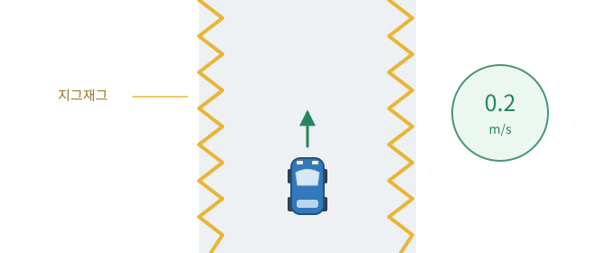

# slow_ws — 방지턱·서행 미션

표지판·지그재그 구간에서 lane 조향을 유지하며 서행합니다.

방지턱 입력은 구독하지만 현재 YOLO 발행자는 없습니다.

## 입력·출력 토픽

토픽 이름·메시지 타입 펼쳐보기

| 방향 | 토픽 | 타입 | 내용 / 연결 |
| --- | --- | --- | --- |
| 입력 | `/yolo/slow_sign` | `std_msgs/msg/Bool` | 서행 표지 |
| 입력 | `/yolo/bump_sign` | `std_msgs/msg/Bool` | 방지턱 표지, 현재 YOLO 발행 비활성 |
| 입력 | `/lane_deep/zigzag` | `std_msgs/msg/UInt8` | 0=없음, 1=한쪽, 2=양쪽; zigzag 활성화 시 |
| 입력 | `/yolo/crosswalk_sign` | `std_msgs/msg/Bool` | 지그재그 종료/재시작 억제 조건 |
| 입력 | `/camera/color/image_raw/compressed` | `sensor_msgs/msg/CompressedImage` | 표지판 이후 새 흰색 ROI |
| 입력 | `/mission/lane` | `ackermann_msgs/msg/AckermannDriveStamped` | 조향·명령 유효성 |
| 입력 | `/start_crosswalk`, `/start_signal` | `std_msgs/msg/Bool` | 횡단보도·신호등으로 제어 인계 |
| 출력 | `/mission/slow/command_04` | `ackermann_msgs/msg/AckermannDriveStamped` | 감속 명령 → mux |
| 출력 | `/slow/mission_active` | `std_msgs/msg/Bool` | 서행/방지턱 활성 → objavoid·웹 |
| 출력 · 관측 | `/slow/white_roi/detected` | `std_msgs/msg/Bool` | 흰색 ROI 판정 |
| 출력 · 관측 | `/slow/white_roi/ratio` | `std_msgs/msg/Float32` | 흰색 픽셀 비율 |
| 출력 · 관측 | `/slow/white_roi/debug/compressed` | `sensor_msgs/msg/CompressedImage` | ROI 미리보기, 구독자가 있을 때 |

## References

- [1] OpenCV, [Thresholding Operations using inRange](https://docs.opencv.org/4.x/da/d97/tutorial_threshold_inRange.html)

[통합 실행](https://github.com/Minjea31/2026-AutoRace/blob/main/tensor_bringup/README.md) · [전체 토픽](../docs/architecture.md)
