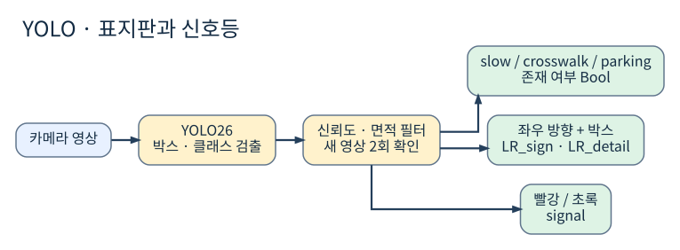

# yolo_ws — 표지판·신호등 인식

카메라 영상에서 표지판과 신호등을 검출해 각 미션에 결과를 전달합니다. 현재 실차는 `yolo_detect` 노드와 `model/best.engine`을 사용합니다.

## 알고리즘

YOLO26 검출에 신뢰도·박스 면적·새 영상 2회 연속 확인 조건을 적용합니다. 표지판 존재 여부와 좌우 방향·신호등 결과를 각 미션에 전달합니다. 현재 방지턱 클래스의 토픽 발행은 꺼져 있습니다. [1]



## 검출 설정

현재 [CLASS_THRESHOLDS](src/yolo_detect.py)를 기준으로 합니다. 최소 면적은 추론 입력 비율이 아니라 원본 영상 박스의 픽셀 면적입니다.

| 클래스 | 최소 confidence | 최소 면적(px²) |
| --- | ---: | ---: |
| bump (토픽 발행 비활성) | 0.55 | 1800 |
| slow | 0.55 | 1500 |
| crosswalk | 0.60 | 2000 |
| parking | 0.60 | 2000 |
| left / right | 0.65 | 2000 |
| red / green | 0.60 | 3000 |

기본 엔진은 고정 입력 1×3×640×640, batch 1입니다. 다른 GPU·TensorRT 환경에서는 대상 장치에서 엔진을 다시 생성합니다. CPU에서는 `.pt` 모델과 `device:=cpu`를 사용합니다. 모델 클래스는 slow/bump/crosswalk/left/right/parking/red/green이며 OCR로 방향을 판단하지 않습니다.

## 빌드와 실행

```bash
source /opt/ros/humble/setup.bash
cd ~/2026-AutoRace/yolo_ws
rosdep install --from-paths src --ignore-src -r -y
python3 -m pip install -e ./yolo26
colcon build --symlink-install --packages-select yolo_detect
source install/setup.bash
export ROS_DOMAIN_ID=94 ROS_LOCALHOST_ONLY=0
ros2 run yolo_detect yolo_detect --ros-args -p show_image:=false
```

PyTorch·Ultralytics는 노드를 실행하는 Python 환경에 설치되어 있어야 합니다. 기존 `dl_env`를 사용한다면 ROS 환경과 해당 환경을 source한 뒤 실행합니다. 통합 실행은 `tensor_bringup`이 `yolo26` 경로와 모델을 설정합니다.

```bash
# CPU 모델 사용
ros2 run yolo_detect yolo_detect --ros-args \
  -p model_path:=$HOME/2026-AutoRace/yolo_ws/model/best.pt -p device:=cpu

# 원본 ROS Image 사용
ros2 run yolo_detect yolo_detect --ros-args \
  -p image_transport:=raw -p image_topic:=/camera/color/image_raw
```

`show_image=true`는 검출 창을 켭니다. 디버그 영상은 실제 미션 신호를 발행한 박스를 클래스 색으로, 조건 미충족 박스를 회색으로 표시합니다. 좌회전 false·빨간불 false도 유효한 발행으로 표시합니다. 카메라 미수신·처리 실패는 ROS 로그로 보고합니다.

## 모델 학습

데이터 설정은 `train/dataset.yaml`, 데이터 폴더는 `train/dataset/{train,valid,test}/{images,labels}`입니다. 데이터·학습 산출물은 Git에서 제외합니다.

```bash
conda activate yolo
python yolo_ws/train/train_baseline_model.py
```

기본 시작 모델은 `yolo_ws/yolo26n.pt`, 학습 결과는 `train/checkpoints/`를 사용합니다. 설치본에 새 모델·소스를 반영하려면 다시 빌드하고 노드를 재시작합니다.

## References

- [1] G. Jocher et al., **Ultralytics YOLO26: Unified Real-Time End-to-End Vision Models**, 2026. [논문](https://arxiv.org/abs/2606.03748), [공식 문서](https://docs.ultralytics.com/models/yolo26/). 검출기 계열의 구조 자료이며, 본 저장소의 표지판 후처리와 미션 토픽 정책은 별도 구현입니다.
